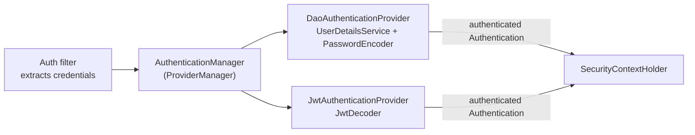

# Spring Security

> [!abstract] What this is
> How Spring Security (7.x on Boot 4) protects an application: the **security filter chain** and the order of its filters, **authentication** (`AuthenticationManager`, providers, `UserDetailsService`, password encoding), the **`SecurityContext`** and how it's stored, **authorisation** for URLs and methods, **JWT resource servers** and **OAuth2 login**, **CSRF** and **CORS**, and the 7.x additions (**MFA**, removal of the `and()` DSL). The decision this helps with: configuring a stateless API or a browser app correctly, and debugging 401/403 responses.

---

## Why It Matters

- Security misconfiguration is a real vulnerability, not a style issue: permit-all fall-throughs, disabled CSRF on cookie-based apps, JWTs accepted without audience checks, method security bypassed by self-invocation.
- "Explain the Spring Security filter chain" and "how does a JWT get validated?" are standard backend interview questions.

---

## The Filter Chain

```mermaid
flowchart LR
    R["Request"] --> DFP["DelegatingFilterProxy<br/>(servlet filter)"]
    DFP --> FCP["FilterChainProxy"]
    FCP -->|"first SecurityFilterChain whose matcher fits"| SFC["SecurityFilterChain"]
    subgraph SFC_["Filters in order (simplified)"]
        F1["SecurityContextHolderFilter"] --> F2["HeaderWriterFilter"] --> F3["CorsFilter"] --> F4["CsrfFilter"] --> F5["LogoutFilter"]
        F5 --> F6["Authentication filters<br/>(BearerToken, UsernamePassword, OAuth2Login)"]
        F6 --> F7["AnonymousAuthenticationFilter"] --> F8["ExceptionTranslationFilter"] --> F9["AuthorizationFilter"]
    end
    SFC --> SFC_
    F9 --> DS["DispatcherServlet"]
```



- Spring Security is a set of **servlet filters** in front of the `DispatcherServlet` ([[04 - Spring MVC Request Lifecycle]]). `DelegatingFilterProxy` bridges the servlet container to the Spring bean `FilterChainProxy`, which picks the **first matching `SecurityFilterChain`**.
- Multiple chains: e.g. one for `/api/**` (stateless JWT), one for `/actuator/**`, one for the browser UI. **Order matters**: a broad chain first swallows everything.
- **`ExceptionTranslationFilter`** turns `AuthenticationException` into **401** (via an `AuthenticationEntryPoint`) and `AccessDeniedException` into **403** (via an `AccessDeniedHandler`). Unauthenticated users hitting a protected resource get 401, authenticated users without permission get 403.
- Debug: `logging.level.org.springframework.security=TRACE` prints the chain chosen and each filter's decision.

### Configuration (Security 6/7 style)

```java
@Configuration
@EnableMethodSecurity
class SecurityConfig {
    @Bean
    @Order(1)
    SecurityFilterChain api(HttpSecurity http) throws Exception {
        return http
            .securityMatcher("/api/**")
            .authorizeHttpRequests(auth -> auth
                .requestMatchers(HttpMethod.GET, "/api/products/**").permitAll()
                .requestMatchers("/api/admin/**").hasRole("ADMIN")
                .anyRequest().authenticated())                 // default deny for everything else
            .oauth2ResourceServer(rs -> rs.jwt(Customizer.withDefaults()))
            .sessionManagement(s -> s.sessionCreationPolicy(SessionCreationPolicy.STATELESS))
            .csrf(csrf -> csrf.disable())                      // OK: stateless, bearer tokens, no cookies
            .cors(Customizer.withDefaults())
            .build();
    }
}
```

- `WebSecurityConfigurerAdapter` was removed in **6.0**; configuration is `SecurityFilterChain` beans with the **lambda DSL**. Security **7** removed the old `and()` chaining and `AntPathRequestMatcher`-based APIs.
- Rules are evaluated **in order**; put specific matchers before general ones, and always end with `anyRequest()` (prefer `authenticated()` or `denyAll()`).

---

## Authentication



- An **authentication filter** extracts credentials (form login, basic, bearer token) into an unauthenticated `Authentication`, and the **`ProviderManager`** asks each `AuthenticationProvider` until one succeeds.
- **Passwords**: `DelegatingPasswordEncoder` (`{bcrypt}...`, `{argon2}...` prefixes) so algorithms can be upgraded; never store plain or fast hashes. `UserDetailsService` loads the user; don't leak "user not found" vs "wrong password" in responses.
- **`SecurityContextHolder`** stores the `Authentication` in a **`ThreadLocal`** by default. It does not follow to `@Async` threads unless propagated (`DelegatingSecurityContextExecutor`, Boot 4.1 `@Async` context propagation), and WebFlux uses the Reactor `Context` instead ([[05 - Spring WebFlux and Reactive]]).
- Browser apps persist the context in the **HTTP session** (`HttpSessionSecurityContextRepository`); stateless APIs re-authenticate every request from the token.
- **Multi-factor authentication** (7.0): built-in support for requiring several factors (password, one-time token, WebAuthn passkeys), tracked as factor authorities, enforceable site-wide or per endpoint.

---

## Authorisation

| Level | How | Notes |
|---|---|---|
| **URL** | `authorizeHttpRequests` rules | Coarse-grained; first match wins |
| **Method** | `@EnableMethodSecurity` + `@PreAuthorize("hasRole('ADMIN')")`, `@PostAuthorize`, `@PreFilter` | Fine-grained, close to business logic; **proxy-based**: self-invocation bypasses it ([[03 - Spring AOP and Proxies]]) |
| **Domain object** | `@PreAuthorize("@orderSecurity.canView(#id, authentication)")` | Ownership checks (is this the user's order?) |

- **Roles vs authorities**: `hasRole("ADMIN")` checks the authority `ROLE_ADMIN`; JWT scopes become `SCOPE_orders.read` authorities by default.
- **Broken object-level authorisation** (user A reads `/orders/123` owned by B) is the most common API vulnerability. URL rules can't catch it; check ownership in the service or with domain-level expressions.

---

## JWT Resource Server

```yaml
spring:
  security:
    oauth2:
      resourceserver:
        jwt:
          issuer-uri: https://auth.example.com/realms/shop   # discovers JWKS, validates iss
          audiences: orders-api                              # validate aud
```

1. `BearerTokenAuthenticationFilter` extracts `Authorization: Bearer <jwt>`.
2. `JwtDecoder` checks the **signature** with keys from the issuer's **JWKS** endpoint (cached, refreshed on unknown `kid`), then **`exp`/`nbf`**, **`iss`**, and **`aud`** if configured.
3. `JwtAuthenticationConverter` maps claims to authorities (scopes by default; customise for `roles` claims).

- Always validate **audience**: otherwise a token issued for another API on the same identity provider is accepted.
- JWTs can't be revoked before expiry without extra machinery: keep access tokens short-lived (5–15 min), use refresh tokens at the client, or opaque tokens with introspection when revocation must be immediate.
- Don't put sensitive data in JWT claims: they're signed, not encrypted.

### OAuth2 / OIDC login (browser apps)

- `oauth2Login()` implements the authorization-code flow (with PKCE) against an identity provider; the result is a server-side session. For SPAs, a **backend-for-frontend** that holds tokens server-side and gives the browser an HttpOnly session cookie is safer than storing tokens in browser storage.
- Spring Authorization Server provides your own OAuth2/OIDC provider when needed (since 7, part of the core Spring Security project).

---

## CSRF and CORS

| | CSRF | CORS |
|---|---|---|
| Problem | A malicious site makes the **browser** send a request **with your cookies** | Browsers block cross-origin JS from reading responses unless the server allows it |
| Needed when | Authentication via **cookies/sessions** | A browser app on another origin calls your API |
| Spring default | **Enabled**: state-changing requests need a token | Disabled until configured |
| Safe to disable | Stateless APIs using `Authorization` headers only | — (configure explicit origins instead) |

- Never disable CSRF on a cookie-session app because "the frontend broke"; send the token (Spring's `CookieCsrfTokenRepository` for SPAs).
- CORS: configure a `CorsConfigurationSource` with explicit origins, methods and headers; `allowedOrigins("*")` with credentials is rejected. CORS must be handled **before** authentication, so preflight `OPTIONS` requests don't get 401 (`http.cors(...)` does this).
- CORS is not access control: non-browser clients ignore it.

---

## Hardening Checklist

- Default deny (`anyRequest().authenticated()` or `denyAll()`); explicit `permitAll` only for public endpoints.
- Separate chain for **Actuator**: expose only `health`/`info` publicly; everything else authenticated or on a separate management port ([[12 - Spring Observability]]).
- Security headers (HSTS, `X-Content-Type-Options`, frame options, CSP for UIs) are on by default; keep them.
- Rate-limit authentication endpoints; lock out or slow down brute force.
- Test security: `@WithMockUser`, `jwt()` request post-processors in MockMvc, and tests for **denied** access, not just allowed ([[13 - Spring Boot Testing]]).

---

## Failure Modes

| Failure | What happens | Mitigation |
|---|---|---|
| **Missing `anyRequest()` rule / permissive order** | Endpoints unintentionally public | Default deny; specific before general; tests for 401/403 |
| **Chain order wrong** | Broad chain matches first; API gets form login or vice versa | `securityMatcher` + `@Order` per chain |
| **CSRF disabled on cookie auth** | Cross-site request forgery | Keep CSRF; send tokens from the SPA |
| **No audience validation** | Tokens for other APIs accepted | `audiences` / custom validator |
| **Long-lived JWTs** | Stolen tokens valid for days | Short access tokens; refresh or introspection |
| **Self-invoked `@PreAuthorize` method** | Authorisation skipped | Checks at the entry bean; tests |
| **Object-level checks missing** | Users access others' data | Ownership checks in services |
| **Security context lost in async work** | Anonymous user in background tasks | Context propagation / delegating executors |
| **CORS preflight blocked by auth** | Browser errors on every cross-origin call | `http.cors(...)` in the chain |
| **Actuator exposed** | Env, heap dumps, config leaked | Separate chain/port; minimal exposure |

---

## Interview Lines

> [!tip] Say it like this
> - "Spring Security is a chain of servlet filters picked by `FilterChainProxy`; authentication filters build an `Authentication` via the `AuthenticationManager`, and `AuthorizationFilter` decides at the end, with `ExceptionTranslationFilter` turning failures into 401 or 403."
> - "The `SecurityContext` lives in a `ThreadLocal`, so it doesn't follow async work unless propagated."
> - "For a JWT resource server I set the issuer, which brings JWKS discovery and signature, expiry and issuer checks, and I always add audience validation."
> - "CSRF protection matters for cookie-based sessions; a stateless API with bearer tokens can disable it."
> - "URL rules don't stop users reading each other's objects; ownership checks belong in the service layer or method security, and I test denied cases."

## Related Notes

- [[04 - Spring MVC Request Lifecycle]] · [[03 - Spring AOP and Proxies]] · [[12 - Spring Observability]] · [[13 - Spring Boot Testing]]
- [[10 - AI Gateway Security and Guardrails]] · [[Languages/README]]
