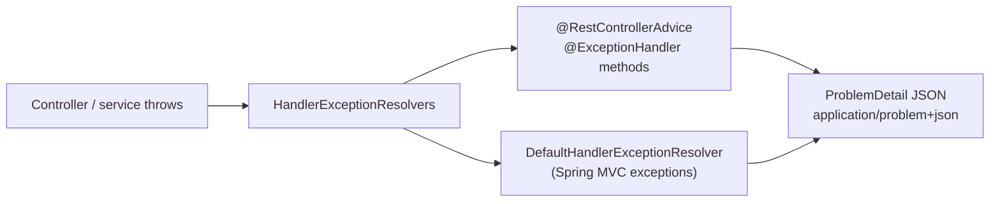

# Spring Validation Errors and API Design

> [!abstract] What this is
> How a Spring Boot API validates input and reports errors consistently: **Bean Validation** (Jakarta Validation 3.1 on Boot 4; `@Valid` vs `@Validated`, groups, custom constraints, method validation), centralised error handling with **`@RestControllerAdvice`** and **Problem Details** (RFC 9457), and the API-design decisions Spring supports directly: status codes, pagination, idempotency, ETags, and built-in **API versioning** in Framework 7. The decision this helps with: designing a predictable error contract and evolving an API without breaking clients.

---

## Why It Matters

- Inconsistent errors (HTML error pages, stack traces, five different JSON shapes) make clients fragile and leak internals.
- Validation in the wrong place lets bad data reach the database or makes every layer re-check the same thing.
- API versioning and deprecation are standard senior design questions; Spring 7 now has a first-class answer.

---

## Bean Validation

```java
public record CreateOrderRequest(
        @NotBlank String customerId,
        @NotEmpty List<@Valid OrderLine> lines,            // cascade into elements
        @Size(max = 500) String note) {}

public record OrderLine(@NotBlank String sku, @Positive int quantity) {}

@RestController
@RequestMapping("/api/orders")
class OrderController {
    @PostMapping
    ResponseEntity<OrderView> create(@Valid @RequestBody CreateOrderRequest req) { ... }

    @GetMapping
    Page<OrderView> list(@RequestParam @Min(0) int page, @RequestParam @Max(100) int size) { ... }
}
```

- **`@Valid`** (Jakarta) triggers validation of an argument and cascades into nested objects. **`@Validated`** (Spring) adds **validation groups** and, on a **class**, enables **method validation** for its parameters and return values via a proxy.
- Since **Framework 6.1**, controller method parameters with constraints (`@Min` on a `@RequestParam`) are validated **built-in**, without `@Validated` on the controller; failures raise `HandlerMethodValidationException`.
- Failures: `@RequestBody` → `MethodArgumentNotValidException`; method validation → `HandlerMethodValidationException` (controllers) or `ConstraintViolationException` (other beans).
- **Custom constraints**: an annotation + `ConstraintValidator`; class-level constraints for cross-field rules (`endDate` after `startDate`).

### Where validation belongs

| Layer | Validates | Example |
|---|---|---|
| **Edge (DTO)** | Shape and syntax | Required fields, lengths, formats, ranges |
| **Domain / service** | Business rules and invariants | Stock available, customer not blocked, state transitions ([[LLD/Foundations/04 - Enums and State Machines]]) |
| **Database** | Last line of defence | `NOT NULL`, unique, foreign keys, check constraints |

- Don't put Bean Validation annotations on **JPA entities** as the only guard; validate DTOs at the edge and enforce invariants in domain objects (constructors, records' compact constructors).

---

## Centralised Error Handling



### Problem Details (RFC 9457)

```json
{
  "type": "https://api.example.com/problems/insufficient-stock",
  "title": "Insufficient stock",
  "status": 409,
  "detail": "SKU A-123 has 2 units, 5 requested",
  "instance": "/api/orders",
  "sku": "A-123"
}
```

- Spring represents it as **`ProblemDetail`** and `ErrorResponse`; enable for built-in MVC exceptions with **`spring.mvc.problemdetails.enabled=true`**. RFC 9457 (2023) replaced RFC 7807 with the same format.

```java
@RestControllerAdvice
class ApiExceptionHandler extends ResponseEntityExceptionHandler {   // handles Spring MVC exceptions as ProblemDetail

    @ExceptionHandler(InsufficientStockException.class)
    ProblemDetail stock(InsufficientStockException e) {
        var pd = ProblemDetail.forStatusAndDetail(HttpStatus.CONFLICT, e.getMessage());
        pd.setType(URI.create("https://api.example.com/problems/insufficient-stock"));
        pd.setTitle("Insufficient stock");
        pd.setProperty("sku", e.sku());
        return pd;
    }

    @ExceptionHandler(Exception.class)
    ProblemDetail unexpected(Exception e) {
        log.error("Unhandled error", e);                                  // full detail in logs, with trace id
        return ProblemDetail.forStatusAndDetail(HttpStatus.INTERNAL_SERVER_ERROR, "Unexpected error");
    }
}
```

- Map **domain exceptions** to statuses in one place; services throw meaningful exceptions (or return result types), controllers stay thin ([[LLD/Foundations/01 - Exception Handling]]).
- Validation errors: include a list of field errors (`field`, `message`), never internal class names.
- **Never** return stack traces or SQL messages: `server.error.include-stacktrace=never` (default) and don't echo exception messages from libraries.
- Include a **trace id** in the response (header or property) so support can find the logs ([[12 - Spring Observability]]).

---

## Status Codes That Matter

| Status | Use |
|---|---|
| 200 / 201 (+ `Location`) / 204 | Success; created; no body |
| 400 | Malformed or invalid input |
| 401 / 403 | Not authenticated / authenticated but not allowed ([[09 - Spring Security]]) |
| 404 | Not found (also used to avoid revealing existence of others' resources) |
| 409 | Conflict: state conflict, duplicate, optimistic-lock failure |
| 412 | Precondition failed (`If-Match` ETag mismatch) |
| 422 | Semantically invalid (some teams use it for validation; pick one convention) |
| 429 | Rate limited (+ `Retry-After`) |
| 500 / 502 / 503 / 504 | Bug / bad upstream response / overloaded or down (+ `Retry-After`) / upstream timeout |

---

## API Design Patterns in Spring

### Pagination

- `Pageable` parameters (`?page=0&size=20&sort=createdAt,desc`) with Spring Data; cap `size` (`spring.data.web.pageable.max-page-size`).
- Offset pagination + `count` is slow on big tables and unstable under inserts; prefer **keyset/cursor** pagination (`?after=<cursor>`) for feeds and large lists ([[07 - Spring Data JPA and Hibernate]]).
- Don't serialise Spring's `Page` implementation directly as your contract; return a stable DTO (Spring Data's `PagedModel` / `@EnableSpringDataWebSupport(pageSerializationMode = VIA_DTO)`).

### Idempotency

- `POST` endpoints that create payments/orders accept an **`Idempotency-Key`** header; store key → result and return the stored result on retries ([[LLD/Foundations/11 - Idempotency and Retries]]).

### Concurrency control with ETags

- Return `ETag` (e.g. the entity `@Version`); require `If-Match` on `PUT`/`PATCH`; respond **412** on mismatch. Prevents lost updates between clients. `ShallowEtagHeaderFilter` only saves bandwidth for `GET`s; it doesn't give concurrency control.

### PATCH

- JSON Merge Patch (`application/merge-patch+json`) or JSON Patch; distinguish "field absent" from "set to null" (DTOs with `Optional`/wrapper types or a `JsonNode`).

---

## API Versioning (Framework 7)

```java
@Configuration
class ApiVersionConfig implements WebMvcConfigurer {
    @Override
    public void configureApiVersioning(ApiVersionConfigurer config) {
        config.useRequestHeader("API-Version")      // or path segment, query param, media type parameter
              .addSupportedVersions("1.0", "1.1", "2.0")
              .setDefaultVersion("1.0");
    }
}

@RestController
@RequestMapping("/api/orders")
class OrderControllerV {
    @GetMapping(path = "/{id}", version = "1.0")  OrderV1 v1(@PathVariable String id) { ... }
    @GetMapping(path = "/{id}", version = "1.1+") OrderV2 v2(@PathVariable String id) { ... }  // 1.1 and later
}
```

- Built into Spring MVC and WebFlux in **Framework 7 / Boot 4**: the version is resolved from a header, path, query parameter or media type, parsed and validated, and used in request mapping. Boot exposes properties (`spring.mvc.apiversion.*`) for the same settings. Clients (`RestClient`, `WebClient`, HTTP interfaces) can send versions too.
- **Deprecation**: Spring can add `Deprecation` and `Sunset` headers for deprecated versions, so clients get warned before removal.

| Strategy | Pros | Cons |
|---|---|---|
| **Path** (`/v2/orders`) | Visible, cacheable, easy routing at gateways | URLs change per version |
| **Header** (`API-Version: 2`) | Stable URLs | Less visible; caches need `Vary` |
| **Media type** (`application/vnd.acme.v2+json`) | Content-negotiation purist | Clunky for clients |
| **Query param** | Easy to try | Mixes with filters; caching |

- Version **only for breaking changes**. Additive changes (new optional fields, new endpoints) don't need a new version if clients ignore unknown fields (Jackson `FAIL_ON_UNKNOWN_PROPERTIES=false`, Boot's default).

---

## Failure Modes

| Failure | What happens | Mitigation |
|---|---|---|
| **No central handler** | Inconsistent error shapes, HTML pages, leaked stack traces | `@RestControllerAdvice` + Problem Details |
| **Exception messages echoed to clients** | Leaks SQL, class names, internals | Curated messages; details only in logs |
| **`@Valid` missing on nested objects/lists** | Nested data unvalidated | `@Valid` on fields and type arguments |
| **Validation only on entities** | Bad input reaches services; errors surface at flush | Validate DTOs at the edge; invariants in domain |
| **Unbounded page size** | `?size=100000` loads the table | Max page size |
| **Offset pagination on huge tables** | Slow deep pages, duplicates under inserts | Keyset pagination |
| **Retried POST creates duplicates** | Double orders/payments | Idempotency keys |
| **Breaking change without a version** | Client outages | Versioning + deprecation headers + contract tests |

---

## Interview Lines

> [!tip] Say it like this
> - "I validate request DTOs with Bean Validation at the edge, enforce business invariants in the domain, and keep database constraints as the last line."
> - "`@Valid` triggers and cascades validation; `@Validated` adds groups and method-level validation; since Framework 6.1 controller parameter constraints are validated without it."
> - "All errors go through one `@RestControllerAdvice` that returns RFC 9457 Problem Details with a trace id, never stack traces."
> - "Spring 7 has built-in API versioning by header, path, query or media type, plus deprecation and sunset headers; I version only breaking changes."
> - "For creates I support idempotency keys, and for updates ETags with `If-Match` to prevent lost updates."

## Related Notes

- [[04 - Spring MVC Request Lifecycle]] · [[09 - Spring Security]] · [[12 - Spring Observability]] · [[13 - Spring Boot Testing]]
- [[LLD/Foundations/01 - Exception Handling]] · [[LLD/Foundations/08 - API and Method Design]] · [[LLD/Foundations/11 - Idempotency and Retries]] · [[Languages/README]]
