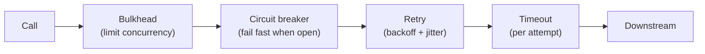

# Spring HTTP Clients Resilience and Messaging

> [!abstract] What this is
> How a Spring Boot service talks to other systems safely: the HTTP clients (**`RestClient`**, `WebClient`, `RestTemplate`, and **HTTP interface clients** auto-configured in Boot 4), **timeouts** and connection pools, resilience patterns (**retries, circuit breakers, bulkheads, rate limiters**) with Resilience4j and Framework 7's built-in `@Retryable`/`@ConcurrencyLimit`, and messaging with **Kafka** and **RabbitMQ** (listeners, acknowledgements, error handling, dead letters, idempotency). The decision this helps with: making one slow or failing dependency degrade a feature instead of taking the service down.

---

## Why It Matters

- Most cascading failures start with an outbound call: no timeout, aggressive retries multiplying load, a shared thread pool drained by one slow dependency.
- Kafka consumers are the other half: a poison message blocking a partition, rebalance storms from slow processing, duplicates after redelivery.

---

## HTTP Clients

| Client | Style | Status | Pick when |
|---|---|---|---|
| **`RestClient`** (6.1 / Boot 3.2) | Fluent, synchronous | Recommended | Default for MVC apps, especially with virtual threads |
| **HTTP interface clients** | Annotated Java interface, implementation generated | Recommended; **auto-configured in Boot 4** | Many endpoints of one API; declarative and testable |
| **`WebClient`** | Fluent, reactive | Recommended for reactive | WebFlux, streaming, reactive composition ([[05 - Spring WebFlux and Reactive]]) |
| **`RestTemplate`** | Template methods, synchronous | Maintenance mode; planned deprecation | Legacy code only |

```java
@HttpExchange("/api/prices")
interface PricingClient {
    @GetExchange("/{sku}")
    Price price(@PathVariable String sku);
}

@Configuration
@ImportHttpServices(group = "pricing", types = PricingClient.class)   // Boot 4: client beans created per group
class ClientsConfig {}
```

```yaml
spring:
  http:
    client:                       # global defaults for auto-configured blocking clients
      connect-timeout: 1s
      read-timeout: 2s
    serviceclient:
      pricing:                    # per group: base URL and client settings
        base-url: https://pricing.internal
```

- Check the exact per-group property names against the Boot version in use; the group mechanism and base-URL configuration are the stable parts.

- Clients sit on a **request factory** (JDK `HttpClient`, Apache HttpClient 5, Jetty, Reactor Netty). Boot picks one from the classpath; configure **connect and read timeouts** and the **connection pool** explicitly ([[11 - Java IO NIO and Networking]]).
- Build clients from Boot's auto-configured **`RestClient.Builder`** so observability (metrics, trace propagation) is applied.
- Boot 4.1 adds **SSRF mitigation** options for auto-configured clients: restrict which hosts/addresses user-influenced URLs may reach (e.g. block link-local metadata endpoints like `169.254.169.254`).

### Timeouts and budgets

- Every call needs **connect timeout**, **read/response timeout**, and a **pool-acquire timeout**; defaults are often infinite or very long.
- Derive them from a **latency budget**: if the endpoint's SLO is 1 s and it calls two services sequentially, they can't each have a 2 s timeout.
- Propagate **deadlines** downstream where possible (gRPC deadlines, a header with remaining budget), and stop work when the caller has given up.

---

## Resilience Patterns

| Pattern | Protects against | Key settings | Trap |
|---|---|---|---|
| **Timeout** | Hanging calls | Per call, below caller's budget | Missing = everything else fails |
| **Retry** (backoff + jitter) | Transient failures (network blips, 503) | 2–3 attempts, exponential backoff, jitter; only **idempotent** operations; only retryable errors | **Retry storms**: N layers × 3 retries = 3ᴺ load |
| **Circuit breaker** | A failing dependency | Failure-rate / slow-call-rate threshold, window, open duration, half-open probes | Fallback that hides real outages; per-instance state |
| **Bulkhead** | One dependency exhausting shared resources | Max concurrent calls (semaphore) or a dedicated pool | Too small = self-inflicted rejections |
| **Rate limiter** | Exceeding a downstream's quota | Permits per period | Client-side only covers this instance |
| **Fallback** | Degraded functionality | Cached/default value, feature hidden | Fallbacks that call another fragile service |



- Resilience4j's Spring Boot integration applies them as annotations (`@CircuitBreaker(name = "pricing", fallbackMethod = "...")`, `@Retry`, `@Bulkhead`, `@RateLimiter`, `@TimeLimiter`) or programmatically. The default aspect order is Retry ( CircuitBreaker ( RateLimiter ( TimeLimiter ( Bulkhead ( call ))))): each retry attempt passes through the breaker. Configure it deliberately.
- **Framework 7** adds `@Retryable` (with backoff, jitter, include/exclude exceptions) and `@ConcurrencyLimit` in the core, enabled by `@EnableResilientMethods`; enough for simple cases, Resilience4j for circuit breakers and rate limiters.
- All annotation-based resilience is **proxy-based** ([[03 - Spring AOP and Proxies]]), and **retries go outside transactions** ([[06 - Spring Transactions]]).
- Monitor: breaker state, retry counts, bulkhead rejections as metrics; alert on open breakers ([[12 - Spring Observability]]).

---

## Kafka with Spring

```java
@KafkaListener(topics = "orders", groupId = "billing", concurrency = "3")
void onOrder(OrderPlaced event) {
    billing.charge(event);           // must be idempotent: Kafka redelivers after failures and rebalances
}
```

### Consumer model

- Each listener container runs consumer threads (`concurrency`); a partition is consumed by **one** consumer in the group at a time, so **useful concurrency ≤ partition count**.
- Offsets are committed by the container (`AckMode.BATCH` by default: after the records from a poll are processed; `RECORD`, `MANUAL` options). Commit **after** processing → **at-least-once** delivery → consumers must be **idempotent** (dedupe by event id, upserts) ([[LLD/Foundations/11 - Idempotency and Retries]]).
- **`max.poll.interval.ms`** (default 5 min): if processing a batch takes longer, the consumer is kicked out and the group **rebalances**; the batch is redelivered elsewhere. Slow handlers cause rebalance loops. Reduce `max.poll.records`, speed up processing, or hand off work carefully.

### Error handling

| Mechanism | Behaviour |
|---|---|
| **`DefaultErrorHandler`** | Retries a failed record in place with backoff (blocking the partition), then calls a recoverer |
| **`DeadLetterPublishingRecoverer`** | Sends the failed record to `<topic>-dlt` with failure headers |
| **Non-blocking retries** (`@RetryableTopic`) | Moves failures to retry topics with delays, so the main partition keeps flowing (ordering per key is lost for retried records) |
| **Non-retryable exceptions** | Deserialization and validation errors go straight to the DLT (`ErrorHandlingDeserializer` for bad payloads) |

- A **poison message** without a DLT blocks its partition forever (infinite retries). Always configure a recoverer.

### Producer side

- `KafkaTemplate.send` is **asynchronous**; check the returned future or configure callbacks, or failures are silent.
- Enable **idempotent producers** (`enable.idempotence=true`, default in modern clients) and `acks=all` for durability.
- **Kafka transactions** (`transactional-id-prefix`) give exactly-once **read-process-write within Kafka**; they don't make a database write and a Kafka send atomic. For DB + event, use the **transactional outbox** ([[06 - Spring Transactions]]).

## RabbitMQ with Spring (briefly)

- `@RabbitListener` with **manual or auto acks**; **prefetch** (`spring.rabbitmq.listener.simple.prefetch`) bounds unacked messages per consumer.
- Failed messages: retry with backoff, then reject without requeue → **dead-letter exchange**. Requeue-on-failure without limits creates hot loops.
- Publisher confirms for reliable sends; quorum queues for durability.

| | Kafka | RabbitMQ |
|---|---|---|
| Model | Partitioned log, consumers track offsets, replayable | Broker routes messages to queues, deleted on ack |
| Ordering | Per partition | Per queue (with one consumer) |
| Pick when | Event streams, high throughput, replay, many consumers | Task queues, complex routing, per-message acks and priorities |

---

## Failure Modes

| Failure | What happens | Mitigation |
|---|---|---|
| **No timeouts** | Threads/connections exhausted by one slow dependency | Connect, read and pool timeouts on every client |
| **Retry storms** | Load multiplies during an outage | Few retries, backoff + jitter, retry at one layer, circuit breakers |
| **Retrying non-idempotent calls** | Duplicate payments/orders | Idempotency keys; retry only safe operations |
| **Shared pool for all dependencies** | One slow dependency starves the others | Bulkheads per dependency |
| **New client per request** | No connection reuse; port exhaustion | Shared clients from the builder |
| **SSRF via user-supplied URLs** | Access to internal services/metadata | Allow-lists, Boot 4.1 SSRF mitigation, no redirects to private ranges |
| **Poison Kafka message** | Partition blocked | Error handler + DLT; `ErrorHandlingDeserializer` |
| **Slow Kafka handler** | Rebalance loops, duplicates | Smaller polls, faster processing, idempotency |
| **Unchecked `KafkaTemplate.send`** | Lost events silently | Handle the future; idempotent producer; outbox |
| **Concurrency > partitions** | Idle consumer threads | Match partitions to target parallelism |

---

## Interview Lines

> [!tip] Say it like this
> - "For new MVC code I use `RestClient` or HTTP interface clients, which Boot 4 auto-configures per service group; `RestTemplate` is in maintenance."
> - "Every outbound call gets connect, read and pool-acquire timeouts derived from the endpoint's latency budget."
> - "Retries only for idempotent operations, with backoff and jitter, at one layer; circuit breakers to fail fast; bulkheads so one dependency can't starve the others."
> - "Kafka listeners are at-least-once, so handlers are idempotent; failed records go to a dead-letter topic so a poison message can't block a partition."
> - "Kafka transactions don't cover the database; for DB plus event I use an outbox."

## Related Notes

- [[11 - Java IO NIO and Networking]] · [[03 - Spring AOP and Proxies]] · [[06 - Spring Transactions]] · [[12 - Spring Observability]] · [[05 - Spring WebFlux and Reactive]]
- [[LLD/Foundations/11 - Idempotency and Retries]] · [[Languages/README]]
