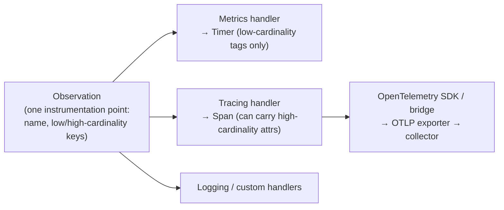

# Spring Observability

> [!abstract] What this is
> How a Spring Boot service exposes what it's doing: **Actuator** endpoints and **health groups** for Kubernetes probes, **Micrometer** metrics (meter types, tags and cardinality, histograms and percentiles), the **Observation API** that produces metrics and traces from one instrumentation point, **distributed tracing** with Micrometer Tracing and **OpenTelemetry**, and **structured logging** with trace correlation. The decision this helps with: wiring probes, metrics, traces and logs so an incident can be diagnosed from dashboards and traces instead of guesswork. General principles are in [[LLD/Foundations/10 - Logging and Observability]] and [[11 - Evals Observability and Silent Drift]].

---

## Why It Matters

- Probes wired to the wrong health checks cause restart storms; metrics with user ids as tags blow up the metrics backend; traces that stop at async boundaries hide the slow hop.
- Boot gives most of this for free, but the defaults need deliberate choices: what to expose, what to tag, how to sample.

---

## Actuator

| Endpoint | Use | Exposure |
|---|---|---|
| `/actuator/health` (+ `/liveness`, `/readiness`) | Probes, load balancer checks | Public (details hidden) |
| `/actuator/info` | Build/git info | Public or internal |
| `/actuator/prometheus` | Metrics scrape | Internal network only |
| `/actuator/metrics` | Browse meters | Internal |
| `/actuator/loggers` | Change log levels at runtime | Secured |
| `/actuator/env`, `/configprops`, `/beans`, `/conditions` | Config debugging ([[02 - Spring Boot Auto-Configuration and Config]]) | Secured; values sanitised |
| `/actuator/threaddump`, `/heapdump` | Diagnostics ([[12 - JVM Diagnostics and Profiling]]) | Secured, never public (heap dumps contain secrets) |

- Only `health` is exposed over HTTP by default. Expose deliberately: `management.endpoints.web.exposure.include=health,info,prometheus`.
- Put Actuator on a **separate management port** (`management.server.port=8081`) not routed by the public ingress, and secure it with its own security chain ([[09 - Spring Security]]).

### Health groups and Kubernetes probes

```yaml
management:
  endpoint:
    health:
      probes:
        enabled: true          # auto-enabled when running on Kubernetes
      group:
        readiness:
          include: readinessState, db, redis      # dependencies the instance needs to serve traffic
        liveness:
          include: livenessState                  # process-local only
```

- **Liveness** = "is this process broken beyond repair?" Only local state. Including the database means a database blip **restarts every pod**.
- **Readiness** = "should this instance get traffic now?" Include critical dependencies, and Boot's `ReadinessState` (set to refusing during startup and graceful shutdown).
- Custom checks: implement `HealthIndicator`; keep them **fast and cached**; a health check that runs a heavy query every second is a load generator ([[13 - Java in Containers and Production Tuning]]).

---

## Micrometer Metrics

| Meter | Measures | Example |
|---|---|---|
| **Counter** | Monotonic count | Orders placed, errors by type |
| **Timer** | Count + total time + max (+ histogram) | Request latency, DB call time |
| **Gauge** | Current value sampled on scrape | Queue depth, cache size, pool active connections |
| **DistributionSummary** | Distribution of non-time values | Payload sizes, basket value |
| **LongTaskTimer** | In-flight long operations | Running batch jobs |

```java
@Component
class CheckoutMetrics {
    private final Counter failures;
    private final Timer checkout;
    CheckoutMetrics(MeterRegistry registry) {
        failures = Counter.builder("checkout.failures").tag("reason", "payment_declined").register(registry);
        checkout = Timer.builder("checkout.duration")
                .publishPercentileHistogram()          // server-side percentiles in Prometheus
                .serviceLevelObjectives(Duration.ofMillis(300), Duration.ofSeconds(1))
                .register(registry);
    }
}
```

- Boot auto-instruments: HTTP server (`http.server.requests` by method, URI **template**, status, outcome, exception), HTTP clients built from Boot builders, JVM (memory, GC, threads), Hikari pools, caches, Kafka, executors, Tomcat.
- **Tags and cardinality**: every unique tag combination is a separate time series. Never tag with user ids, order ids, raw URLs or exception messages. URI tags use the **template** (`/orders/{id}`); a controller that bypasses templating can explode cardinality. Use `MeterFilter`s to cap or drop tags.
- **Percentiles**: client-side percentiles (`publishPercentiles(0.99)`) **can't be aggregated** across instances. Use **histograms** (`publishPercentileHistogram`) and compute percentiles in the backend.
- Common tags for every meter: `application`, `region`, `version` (via `management.metrics.tags.*`), so dashboards can split by deploy.
- RED for services (Rate, Errors, Duration), USE for resources (Utilisation, Saturation, Errors): pool pending, executor queue sizes, GC pause time.

---

## Observation API and Tracing



- Since Boot 3, Spring instruments with Micrometer **`Observation`**: one start/stop around an operation produces both a **timer** and a **span**. Low-cardinality key-values become metric tags; high-cardinality ones only go on spans.
- **Micrometer Tracing** (replacing Spring Cloud Sleuth) with an **OpenTelemetry** bridge, exporting via **OTLP** to a collector (Tempo, Jaeger, vendor backends). Boot 4 adds a dedicated OpenTelemetry starter and 4.1 improves OpenTelemetry support further.
- Propagation: **W3C `traceparent`** headers by default; Boot-built `RestClient`/`WebClient`/Kafka templates inject them automatically. Clients created with `new` and raw thread pools break the trace.
- **Async boundaries**: trace context lives in `ThreadLocal`s (or Reactor `Context`); use context-propagating executors, or Boot 4.1's `@Async` context propagation ([[03 - Spring AOP and Proxies]], [[05 - Spring WebFlux and Reactive]]).
- **Sampling**: `management.tracing.sampling.probability` (default 0.1). 100% in high-traffic production is expensive; prefer tail-based sampling in the collector to keep slow and error traces.
- **Exemplars** link a latency histogram bucket to a trace id, so you can jump from a p99 spike to an actual slow trace.

```java
Observation.createNotStarted("pricing.quote", observationRegistry)
        .lowCardinalityKeyValue("currency", cmd.currency())      // metric tag + span attribute
        .highCardinalityKeyValue("sku", cmd.sku())               // span attribute only
        .observe(() -> pricing.quote(cmd));
```

---

## Structured Logging

- Boot **3.4+** supports structured JSON logging out of the box: `logging.structured.format.console=ecs` (or `logstash`, `gelf`), also for files.
- With tracing enabled, **trace and span ids go into the MDC** and appear in every log line, so logs and traces correlate.
- Log at the right levels; change them at runtime via `/actuator/loggers` instead of redeploying.
- Never log secrets, tokens or full request bodies with personal data; mask at the encoder level.
- Logging is not free: synchronous appenders writing to slow destinations block request threads; use async appenders or log to stdout and let the platform ship logs.

---

## Failure Modes

| Failure | What happens | Mitigation |
|---|---|---|
| **DB in liveness probe** | Restart storm during DB issues | Liveness local only; dependencies in readiness |
| **Heavy health checks** | Load and latency from probes | Cheap, cached indicators |
| **Actuator exposed publicly** | Env, heap dumps, config leaked | Management port, exposure allow-list, security chain |
| **High-cardinality tags** | Metrics backend overload, cost explosion | Templates and bounded tag values; `MeterFilter` |
| **Client-side percentiles aggregated** | Mathematically wrong dashboards | Histograms + backend percentiles |
| **Clients/executors created manually** | No metrics, broken traces | Use Boot builders and context-propagating executors |
| **100% sampling at scale** | Tracing cost and overhead | Probability or tail-based sampling |
| **Unstructured logs without trace ids** | Can't correlate across services | Structured logging + MDC trace ids |

---

## Interview Lines

> [!tip] Say it like this
> - "Liveness checks only the process itself; readiness includes the dependencies needed to serve traffic, so a database blip takes pods out of rotation instead of restarting them."
> - "Boot's Observation API instruments once and produces both a Micrometer timer and a trace span; tracing goes through Micrometer Tracing to OpenTelemetry over OTLP."
> - "I keep tag cardinality bounded and publish histograms rather than client-side percentiles, because percentiles don't aggregate across instances."
> - "Trace ids land in the MDC, so structured JSON logs correlate with traces; async work needs context propagation or the trace breaks."
> - "Actuator lives on a separate management port with only health, info and Prometheus exposed."

## Related Notes

- [[04 - Spring MVC Request Lifecycle]] · [[08 - Spring Database Connections and Migrations]] · [[09 - Spring Security]] · [[13 - Spring Boot Testing]]
- [[12 - JVM Diagnostics and Profiling]] · [[13 - Java in Containers and Production Tuning]] · [[LLD/Foundations/10 - Logging and Observability]] · [[Languages/README]]
