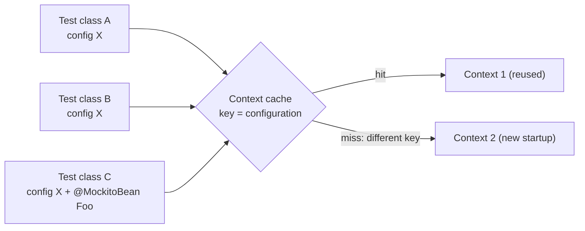

# Spring Boot Testing

> [!abstract] What this is
> How to test a Spring Boot service at the right level and keep the suite fast: plain unit tests, **test slices** (`@WebMvcTest`, `@DataJpaTest`, ...), full **`@SpringBootTest`**, web testing tools (MockMvc / `MockMvcTester`, `RestTestClient`, `WebTestClient`), mocking beans with **`@MockitoBean`**, real dependencies with **Testcontainers** and `@ServiceConnection`, and the **context cache** that makes or breaks suite speed. Boot 4 specifics: JUnit 6, modular test starters, `@MockBean` removed. The decision this helps with: which kind of test to write for a given risk, and why a suite takes 20 minutes.

---

## Why It Matters

- Spring tests that start a full context for every class turn a 2-minute suite into 20 minutes; teams then stop running tests.
- Tests against H2 instead of the real database miss SQL dialect, locking and migration bugs. Testcontainers made real databases the default.
- General testability design (constructor injection, seams, fakes) is in [[LLD/Foundations/09 - Testability]].

---

## Test Levels

| Level | What | Speed | Catches |
|---|---|---|---|
| **Unit** (no Spring) | Class with constructor-injected fakes/mocks | ms | Business logic, edge cases |
| **Slice** | A narrow Spring context for one layer | ~1–3 s per new context | Mapping, validation, serialisation, queries, security rules |
| **Integration** (`@SpringBootTest`) | Full context + real infrastructure (Testcontainers) | Seconds per context | Wiring, transactions, migrations, real SQL |
| **Contract / API** | Consumer-driven contracts, schema checks | Varies | Breaking API changes between services |
| **End-to-end** | Deployed system | Slow | Critical user journeys only |

- Most tests should be **unit** tests: services built with constructor injection need no Spring at all ([[01 - Spring IoC and Bean Lifecycle]]).

---

## Test Slices

| Slice | Loads | Use for |
|---|---|---|
| `@WebMvcTest(OrderController.class)` | MVC infrastructure, the controller, `@ControllerAdvice`, filters, security config, Jackson | Request mapping, validation, error responses, status codes, security rules |
| `@WebFluxTest` | WebFlux equivalent | Reactive controllers |
| `@DataJpaTest` | JPA, repositories, `EntityManager`, Flyway/Liquibase; **transactional, rolls back** | Queries, mappings, N+1 checks, constraints |
| `@DataJdbcTest`, `@JdbcTest` | JDBC data layer | `JdbcClient` queries |
| `@JsonTest` | Jackson configuration | JSON contract of DTOs |
| `@RestClientTest` | `RestClient`/`RestTemplate` with a mock server | Outbound client mapping, error handling |

- Slices exclude services and other components: provide what the slice needs with `@MockitoBean` or `@Import`.
- `@DataJpaTest` replaces the DataSource with an embedded database by default; for real-database tests use `@AutoConfigureTestDatabase(replace = NONE)` with Testcontainers.
- `@DataJpaTest` rolls back each test, so **flush** is needed to see constraint violations and real SQL (`entityManager.flush()`); otherwise the bug only appears in production at commit ([[07 - Spring Data JPA and Hibernate]]).

```java
@WebMvcTest(OrderController.class)
class OrderControllerTest {
    @Autowired MockMvcTester mvc;                   // AssertJ-based MockMvc (Framework 6.2+)
    @MockitoBean OrderService orders;

    @Test
    void rejectsEmptyOrder() {
        assertThat(mvc.post().uri("/api/orders")
                .contentType(MediaType.APPLICATION_JSON)
                .content("""
                        {"customerId":"c1","lines":[]}
                        """))
            .hasStatus(HttpStatus.BAD_REQUEST)
            .bodyJson().extractingPath("$.title").isEqualTo("Bad Request");
    }
}
```

---

## Full Integration Tests

```java
@SpringBootTest(webEnvironment = SpringBootTest.WebEnvironment.RANDOM_PORT)
@Testcontainers
class CheckoutIT {
    @Container @ServiceConnection
    static PostgreSQLContainer<?> postgres = new PostgreSQLContainer<>("postgres:17");

    @Container @ServiceConnection
    static KafkaContainer kafka = new KafkaContainer("apache/kafka:4.1.0");

    @Autowired RestTestClient client;               // Framework 7; TestRestTemplate / WebTestClient also available

    @Test
    void placesOrder() {
        client.post().uri("/api/orders").body(validOrder()).exchange()
              .expectStatus().isCreated();
    }
}
```

- **`@ServiceConnection`** (Boot 3.1+) wires the container's host/port/credentials into the auto-configuration: no `@DynamicPropertySource` boilerplate.
- `webEnvironment`: `MOCK` (default, MockMvc, no server), `RANDOM_PORT` (real server, real HTTP; tests don't share the request thread, so test-managed transactions **don't** roll back server-side work), `NONE`.
- **Containers as `static`** fields: started once per class. For the whole suite, define them in a shared `@TestConfiguration` with `@Bean @ServiceConnection` containers and import it everywhere, or enable Testcontainers **reuse** locally.
- Boot can also run the app locally against containers (`TestApplication` with `SpringApplication.from(App::main).with(ContainersConfig.class)`), sharing config between dev and tests.

---

## Mocking Beans

- **`@MockitoBean` / `@MockitoSpyBean`** (Framework 6.2) replace a bean in the context with a Mockito mock/spy. Boot's `@MockBean`/`@SpyBean` were deprecated in 3.4 and **removed in 4.0**.
- Mock **at boundaries** (external HTTP clients, clocks, message publishers), not your own services in integration tests; otherwise the test verifies the mocks.
- For HTTP dependencies prefer a fake server (WireMock, MockWebServer, `MockRestServiceServer`) over mocking the client interface: it exercises serialisation, headers, timeouts and error mapping.

---

## The Context Cache



- Spring's TestContext framework **caches application contexts** across test classes in the same JVM, keyed by the full configuration: classes, profiles, properties, **mocked beans**, context customizers.
- Every distinct combination = another context startup (seconds each) and more memory. Common cache-busters: a different `@MockitoBean` set per class, per-class `properties = ...`, `@ActiveProfiles` variations, **`@DirtiesContext`**.
- Fixes: a small number of shared base configurations (an abstract base class or meta-annotation with the same mocks and containers), avoid `@DirtiesContext` (reset state instead), keep slices for narrow tests.
- Limits: `spring.test.context.cache.maxSize` (default 32, LRU). Framework 7 can **pause** inactive cached contexts so their schedulers and listeners don't keep running.
- Watch for it: log `org.springframework.test.context.cache=DEBUG` to see hits/misses.

---

## Boot 4 Changes

- **JUnit 6** (Jupiter API continues; JUnit 4 vintage support needs explicit opt-in).
- **Modular test starters** mirroring the new modules (e.g. a web MVC test starter alongside `spring-boot-starter-webmvc`); `TestRestTemplate` lives in its own module. "Classic" test starters ease migration.
- `@MockBean` removed → `@MockitoBean`.
- `RestTestClient` (Framework 7) for testing MVC apps with a fluent client, bound to MockMvc or a live server.

---

## Testing Specific Concerns

| Concern | How |
|---|---|
| Security rules | `@WebMvcTest` + `@WithMockUser` / `jwt()` post-processor; test **403/401** paths ([[09 - Spring Security]]) |
| Transactions and rollback | Integration test with a real DB; assert state after an exception |
| Migrations | Testcontainers DB + Flyway on startup in CI ([[08 - Spring Database Connections and Migrations]]) |
| Kafka listeners | Testcontainers Kafka; Awaitility for async assertions; idempotency on duplicate delivery |
| Time | Inject `Clock`; fixed clocks in tests ([[10 - Java Strings Numbers and Time]]) |
| Architecture rules | ArchUnit (layering, no cycles), Spring Modulith's module verification |
| Concurrency | See [[LLD/Concurrency/17 - Testing Concurrent Code]] |

- Async assertions: **Awaitility** (`await().atMost(5, SECONDS).untilAsserted(...)`), never `Thread.sleep`.

---

## Failure Modes

| Failure | What happens | Mitigation |
|---|---|---|
| **Many unique contexts** | Suite slows to tens of minutes | Shared configurations; few mock combinations; no `@DirtiesContext` |
| **`@SpringBootTest` for everything** | Slow, coarse feedback | Unit tests and slices first |
| **H2 instead of the real DB** | Dialect/locking/migration bugs reach prod | Testcontainers with the production engine and version |
| **`@DataJpaTest` without flush** | Constraint errors never seen in tests | `flush()` in tests that check persistence |
| **Expecting rollback with `RANDOM_PORT`** | Data leaks between tests | Clean up explicitly or use unique data |
| **Mocking your own services in integration tests** | Tests prove nothing | Mock only external boundaries |
| **`Thread.sleep` in async tests** | Flaky and slow | Awaitility |
| **Only happy-path security tests** | Unprotected endpoints unnoticed | Test denied access for every rule |

---

## Interview Lines

> [!tip] Say it like this
> - "Most logic gets plain unit tests; slices like `@WebMvcTest` and `@DataJpaTest` test one layer with a narrow context; `@SpringBootTest` with Testcontainers covers wiring, transactions and real SQL."
> - "`@ServiceConnection` wires Testcontainers into Boot's auto-configuration, so tests run against the same Postgres and Kafka versions as production."
> - "Spring caches test contexts by configuration, so every different set of `@MockitoBean`s or properties costs a new context; I standardise on a few shared setups and avoid `@DirtiesContext`."
> - "In Boot 4 `@MockBean` is gone; `@MockitoBean` from Spring Framework replaces it."
> - "I test denied-access cases for security rules, not just the allowed ones."

## Related Notes

- [[01 - Spring IoC and Bean Lifecycle]] · [[07 - Spring Data JPA and Hibernate]] · [[09 - Spring Security]] · [[10 - Spring Validation Errors and API Design]]
- [[LLD/Foundations/09 - Testability]] · [[LLD/Concurrency/17 - Testing Concurrent Code]] · [[Languages/README]]
