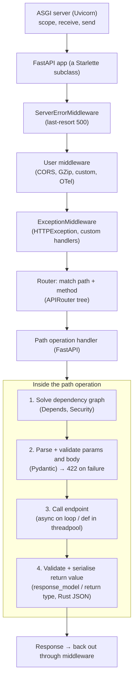

# FastAPI Architecture

> [!abstract] What this is
> How FastAPI is put together: a **Starlette** ASGI application (middleware stack, router, request/response classes) extended with a **path-operation layer** that reads type hints to **resolve dependencies**, **parse and validate** inputs with Pydantic, call your function, and **serialise** the result through a response model; plus **OpenAPI** generation from the same metadata. The decision this helps with: knowing which layer handles what (middleware vs dependency vs exception handler vs response model), so behaviour, errors and performance are predictable.

---

## Why It Matters

- Most FastAPI confusion comes from not knowing which layer runs when: why middleware can't see the parsed body, why an exception becomes a 500 instead of your handler's response, why response fields disappear.
- The same type hints drive validation, documentation and serialisation: changing a model changes all three.

---

## The Layers



| Layer | Sees | Use for |
|---|---|---|
| **ASGI middleware** (`app.add_middleware`) | Raw ASGI events, every request (including 404s, docs, static) | CORS, compression, request IDs, timing, tracing, security headers |
| **Exception handlers** (`@app.exception_handler`) | Exceptions raised in routes/dependencies | Mapping domain errors to HTTP responses ([[07 - FastAPI Security and Middleware]]) |
| **Dependencies** (`Depends`) | One path operation's inputs; can raise `HTTPException` | Auth, DB sessions, pagination, shared params ([[03 - FastAPI Dependency Injection]]) |
| **Path operation** | Validated, typed arguments | Business logic call |
| **Response model** | The return value | Output validation, filtering, serialisation |

---

## Path Operations

```python
from typing import Annotated
from fastapi import FastAPI, APIRouter, Depends, Path, Query, status
from pydantic import BaseModel, Field

class OrderIn(BaseModel):
    customer_id: str
    lines: list[str] = Field(min_length=1)

class OrderOut(BaseModel):
    id: str
    status: str

router = APIRouter(prefix="/orders", tags=["orders"])

@router.post("", status_code=status.HTTP_201_CREATED)
async def create_order(body: OrderIn, svc: Annotated[OrderService, Depends(get_order_service)]) -> OrderOut:
    return await svc.create(body)

@router.get("/{order_id}")
async def get_order(
    order_id: Annotated[str, Path(min_length=3)],
    svc: Annotated[OrderService, Depends(get_order_service)],
    expand: Annotated[bool, Query()] = False,
) -> OrderOut:
    return await svc.get(order_id, expand=expand)

app = FastAPI(title="Orders")
app.include_router(router, prefix="/api")
```

- **Where parameters come from** is inferred from the signature: names in the path → path params; Pydantic models → JSON body; simple types → query params; explicit `Header()`, `Cookie()`, `Form()`, `File()` otherwise. Groups of query/header params can be a Pydantic model (0.115).
- **Validation failures** return **422** with a structured error list, before your code runs. Since 0.132, JSON bodies also require a JSON `Content-Type`.
- **Return type or `response_model`**: the returned object is validated against it and **filtered** to its fields (an internal model with `password_hash` returned through `UserOut` won't leak it), then serialised to JSON by Pydantic's Rust core (0.130).
- Without a return type/`response_model`, FastAPI falls back to `jsonable_encoder` + `JSONResponse`: slower and no output contract.
- Returning a `Response` subclass directly (`JSONResponse`, `StreamingResponse`, `FileResponse`) **bypasses** response-model processing.

---

## Routing

- `APIRouter`s group operations with shared `prefix`, `tags`, `dependencies` and `responses`; `include_router` nests them. Since 0.137 routers are kept as a **tree** rather than copied into the app, and `router.routes` is an internal detail.
- Matching is in **declaration order**: `/users/me` must be declared before `/users/{user_id}`, or `me` is parsed as an id.
- Path parameters with types (`{order_id}` as `int`) are validated; use `Path(pattern=...)` for formats.
- Sub-applications (`app.mount("/admin", admin_app)`) are separate ASGI apps with their own OpenAPI and middleware.

---

## OpenAPI and Docs

- FastAPI builds an **OpenAPI 3.1** document from routes, parameter declarations and Pydantic JSON Schemas: served at `/openapi.json`, with **Swagger UI** at `/docs` and **ReDoc** at `/redoc`.
- The schema is a **contract**: generate clients from it, diff it in CI to catch breaking changes, and review it in PRs.
- Disable or protect docs in production if the API is private: `FastAPI(docs_url=None, redoc_url=None, openapi_url=None)` or put them behind auth.
- Document errors with `responses={404: {"model": ProblemDetail}}` so clients see them in the schema.

---

## Application State and Lifespan

```python
from contextlib import asynccontextmanager
import httpx

@asynccontextmanager
async def lifespan(app: FastAPI):
    app.state.http = httpx.AsyncClient(timeout=httpx.Timeout(5.0))   # one pooled client per worker process
    app.state.db = create_async_engine(settings.database_url)
    yield
    await app.state.http.aclose()
    await app.state.db.dispose()

app = FastAPI(lifespan=lifespan)
```

- The **lifespan** runs once **per worker process** at startup/shutdown (ASGI lifespan protocol): the place for pools, clients, ML models and background task groups ([[08 - FastAPI Background Work]]). `@app.on_event` is the deprecated predecessor.
- Access shared resources through dependencies (`request.app.state.http`) so tests can override them.

---

## Failure Modes

| Failure | What happens | Mitigation |
|---|---|---|
| **Business logic in middleware** | Runs for every request including 404/docs; can't see parsed inputs | Dependencies for per-route concerns |
| **Route order shadowing** | `/users/me` handled by `/users/{id}` | Declare specific routes first |
| **No response model / return type** | Internal fields leak; slower serialisation | Explicit output models |
| **Returning `Response` objects everywhere** | No validation or schema for outputs | Return models; use `Response` only when needed |
| **Docs exposed publicly** | Attack surface mapped for attackers | Disable or protect docs/OpenAPI in prod |
| **Resources created at import time** | Shared across forked workers; hard to test | Lifespan + dependencies |
| **Unpinned FastAPI/Starlette** | Behaviour changes between minors | Lockfile ([[00 - FastAPI Version History and Ecosystem]]) |

---

## Interview Lines

> [!tip] Say it like this
> - "FastAPI is a Starlette ASGI app; a request goes through the middleware stack and router, then FastAPI solves dependencies, validates inputs with Pydantic, calls the endpoint and serialises the return value through the response model."
> - "Middleware sees every raw request; dependencies are per-route and get typed inputs; exception handlers map errors to responses."
> - "The response model is also a filter, so internal fields don't leak, and since 0.130 serialisation runs in Pydantic's Rust core."
> - "OpenAPI is generated from the same type hints, so the schema is the contract; I diff it in CI."
> - "Pools, clients and models are created in the lifespan, once per worker process."

## Related Notes

- [[00 - FastAPI Version History and Ecosystem]] · [[02 - FastAPI Request Lifecycle and Sync vs Async]] · [[03 - FastAPI Dependency Injection]] · [[04 - Pydantic v2 Deep Dive]] · [[07 - FastAPI Security and Middleware]]
- [[06 - WSGI vs ASGI and Python Servers]] · [[04 - Spring MVC Request Lifecycle]] · [[Languages/README]]
