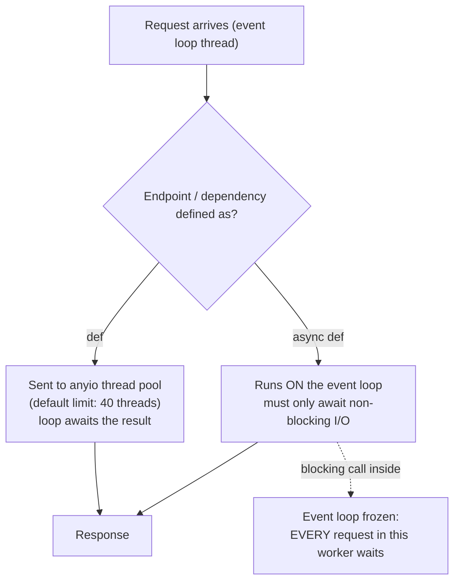

# FastAPI Request Lifecycle and Sync vs Async

> [!abstract] What this is
> The single most important FastAPI production topic: **`async def` endpoints run on the event loop**, **`def` endpoints (and `def` dependencies) run in a thread pool**, and what that means under the GIL. Covers the **blocking-call outage** (sync I/O inside `async def` freezes every request in the worker), the **thread pool limit** (40 threads by default) as a hidden concurrency cap, CPU-bound work, how to call sync code from async and vice versa, and a decision table. The decision this helps with: choosing `async def` or `def` per endpoint and per library, and diagnosing a FastAPI service whose latency collapses under load.

---

## Why It Matters

- The classic FastAPI incident: someone calls `requests.get()` or a sync DB driver inside an `async def` endpoint. Under light load nothing seems wrong; under real load **all requests in that worker** wait behind each blocking call, p99 explodes, health checks time out and pods restart.
- The reverse mistake (everything as `def`) quietly caps concurrency at the thread pool size and adds thread-switching overhead.

---

## Two Execution Paths



| | `async def` | `def` |
|---|---|---|
| Runs on | The worker's **event loop** thread | A thread from anyio's **default thread pool** |
| Blocking I/O inside | **Freezes the whole worker** | Fine: blocks one pool thread (GIL released while waiting) |
| Concurrency per worker | Thousands of concurrent awaits | **≤ thread pool size** (40 by default) running at once; the rest queue |
| Overhead | Lowest | Thread handoff per call |
| Use with | Async libraries: `httpx.AsyncClient`, asyncpg / async SQLAlchemy, `redis.asyncio`, async LLM SDKs | Sync libraries: `requests`, sync SQLAlchemy/psycopg, boto3, most SDKs |

- The same rule applies to **dependencies**: a `def` dependency runs in the thread pool even if the endpoint is `async def`; an `async def` dependency runs on the loop.
- Pydantic validation, response serialisation and your own Python code all run on the loop thread (or the pool thread) and hold the **GIL** while they work ([[03 - The GIL and Free-Threaded Python]]).

---

## The Blocking-Call Outage

```python
import requests, httpx

@app.get("/price/{sku}")
async def price_bad(sku: str):
    r = requests.get(f"{PRICING}/{sku}", timeout=5)   # BLOCKS the event loop for up to 5 s
    return r.json()

@app.get("/price/{sku}")
async def price_good(sku: str, http: Annotated[httpx.AsyncClient, Depends(get_http)]):
    r = await http.get(f"/{sku}")                      # suspends; the loop serves other requests
    return r.json()

@app.get("/price/{sku}")
def price_sync_ok(sku: str):                           # sync library in a def endpoint: runs in the thread pool
    return requests.get(f"{PRICING}/{sku}", timeout=5).json()
```

- One worker, 100 concurrent requests, a 200 ms blocking call inside `async def`: requests are served **one at a time**, so the last waits 20 s. With `httpx.AsyncClient` they overlap and all finish in ≈200 ms.
- Common hidden blockers: sync DB drivers or ORMs, `requests`, boto3/cloud SDKs, `time.sleep`, reading large files, CPU-heavy work (JSON of many MB, image processing, tokenisation, PDF parsing), synchronous logging to slow sinks, sync Redis clients.
- Detection: event-loop lag metrics, asyncio debug mode (slow callback warnings), sampling profilers showing time in sync I/O on the loop thread, and the symptom pattern "latency rises with concurrency while CPU stays low" ([[05 - asyncio Internals]], [[13 - Python Performance and Profiling]]).

---

## The Thread Pool Limit

- Sync endpoints and dependencies use anyio's **default capacity limiter: 40 tokens**. The 41st concurrent sync call waits for a free thread, even if the CPU is idle.
- Symptoms: a `def`-heavy service plateaus at roughly `40 / avg_latency` requests per second per worker.
- Options: make I/O paths `async`; raise the limit carefully at startup (`anyio.to_thread.current_default_thread_limiter().total_tokens = 100` in the lifespan); add workers. More threads under the GIL help only for I/O waits, not CPU work, and each needs memory and DB connections.
- The DB pool must match: 40 threads competing for a 10-connection pool just move the queue ([[05 - FastAPI Data Access with SQLAlchemy]]).

---

## Mixing Sync and Async Correctly

| Need | Do |
|---|---|
| Call a **sync** library from `async def` | `await anyio.to_thread.run_sync(fn, arg)` / `await asyncio.to_thread(fn, arg)` / `fastapi.concurrency.run_in_threadpool` (or Asyncer's `asyncify`) |
| **CPU-bound** work from `async def` | A **process pool** (`loop.run_in_executor(process_pool, fn, data)`), a task queue, or native code that releases the GIL ([[04 - Python Threads Processes and Executors]]) |
| Call **async** code from sync code (scripts, Celery tasks) | `anyio.run` / `asyncio.run` at the top level only; never inside a running loop |
| Library offers both | Prefer the async API in `async def` endpoints |
| Mostly sync codebase (sync SQLAlchemy, Django ORM habits) | Use `def` endpoints consistently; tune the thread pool and workers |

- Don't wrap everything in `to_thread`: each call costs a thread handoff and counts against the same 40-token limiter.
- A sync DB session created in a `def` dependency and used in an `async def` endpoint mixes threads and the loop: keep a request's DB work on one side.

---

## Decision Table

| Endpoint does | Define as |
|---|---|
| Only async I/O (async DB, `httpx.AsyncClient`, async LLM SDK) | **`async def`** |
| Sync I/O libraries only | **`def`** |
| Mostly async plus one sync SDK call | `async def` + `to_thread` for that call |
| Pure in-memory work, fast (< 1 ms) | Either; `async def` avoids thread overhead |
| CPU-heavy work (> ~10 ms) | `async def` + process pool / queue; never inline |
| Streaming responses (SSE, LLM tokens) | `async def` with an async generator ([[06 - FastAPI Streaming SSE and WebSockets]]) |

---

## The Full Request Path, Timed

1. Uvicorn reads the request on the loop and calls the ASGI app.
2. Middleware runs (on the loop).
3. Routing, then **dependencies** (loop or pool, per definition), then **validation** of params/body (on the calling thread).
4. Endpoint runs (loop or pool).
5. Response validation/serialisation (Pydantic Rust core since 0.130), then middleware unwinds, then the body is sent.
6. Yield-dependency teardown (after the response, by default) and background tasks run ([[03 - FastAPI Dependency Injection]], [[08 - FastAPI Background Work]]).

- **No request timeout** exists by default in FastAPI or Uvicorn: set client timeouts on every downstream call, `asyncio.timeout` around slow sections, and timeouts at the proxy/load balancer ([[09 - FastAPI Production Deployment]]).

> [!info] Free-threaded build (extra)
> On `python3.14t`, `def` endpoints in the thread pool can run Python code in parallel across cores, which makes sync endpoints scale better for CPU-light work. The event-loop rule doesn't change: blocking inside `async def` still freezes the loop. Check that FastAPI's dependencies (Pydantic core, Uvicorn, drivers) support free-threading before relying on it.

---

## Failure Modes

| Failure | What happens | Mitigation |
|---|---|---|
| **Sync I/O inside `async def`** | Whole worker stalls; latency grows with concurrency | Async libraries, `def` endpoints, or `to_thread` |
| **CPU work inside `async def`** | Same stall, high CPU | Process pool, queue, native code |
| **All endpoints `def` under high concurrency** | Capped at ~40 concurrent per worker | Async I/O; tune limiter; more workers |
| **Thread pool larger than DB pool** | Threads wait on connections | Size both together |
| **`asyncio.run` inside a handler** | "cannot be called from a running event loop" | `await` directly |
| **Sync dependency in an async endpoint** | Hidden thread handoff per request | Make cheap deps `async def` |
| **No downstream timeouts** | Requests hang until the client gives up | Timeouts on every client; `asyncio.timeout` |

---

## Interview Lines

> [!tip] Say it like this
> - "`async def` endpoints run on the event loop and `def` endpoints run in anyio's thread pool, so the rule is: async libraries in `async def`, sync libraries in `def`."
> - "One blocking call inside `async def` freezes every request in that worker; the symptom is latency growing with concurrency while CPU stays low."
> - "Sync endpoints are capped by the 40-thread default limiter per worker, and those threads need DB connections too."
> - "From async code I push sync calls to `to_thread` and CPU-heavy work to a process pool or a queue, never inline."
> - "There's no default request timeout, so every downstream client gets timeouts and the proxy enforces an overall limit."

## Related Notes

- [[01 - FastAPI Architecture]] · [[03 - FastAPI Dependency Injection]] · [[05 - FastAPI Data Access with SQLAlchemy]] · [[09 - FastAPI Production Deployment]]
- [[05 - asyncio Internals]] · [[04 - Python Threads Processes and Executors]] · [[03 - The GIL and Free-Threaded Python]] · [[05 - Spring WebFlux and Reactive]] · [[Languages/README]]
