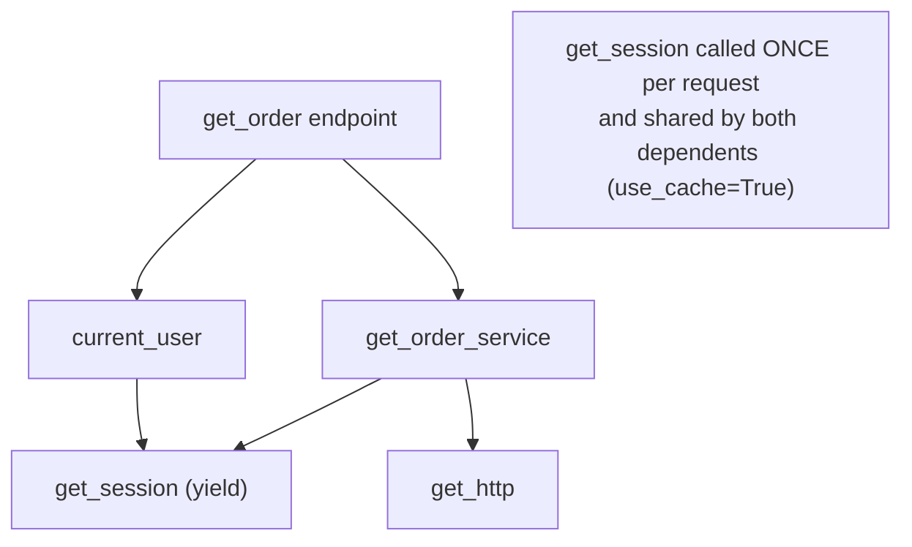

# FastAPI Dependency Injection

> [!abstract] What this is
> FastAPI's per-request dependency system: **`Depends`** declared through **`Annotated`** type aliases, the **dependency graph** solved for each request (with per-request **caching**), **yield dependencies** for setup/teardown and their **`scope`** (`"request"` = teardown after the response, the default; `"function"` = right after the endpoint), class-based and parametrised dependencies, router/app-level dependencies, `Security` with scopes, and **`dependency_overrides`** for tests. Also what DI is *not* in FastAPI: there's no singleton container, so app-lifetime objects come from the lifespan. The decision this helps with: structuring sessions, auth, clients and services so they're testable and correctly scoped.

---

## Why It Matters

- Dependencies are where DB sessions are opened and closed, users authenticated, and services wired. Getting their lifetime wrong leaks connections, commits after errors, or breaks streaming responses.
- `dependency_overrides` is the main testing seam in FastAPI apps ([[10 - FastAPI Testing]]).

---

## Basics

```python
from typing import Annotated
from fastapi import Depends, Request, HTTPException, status

async def get_http(request: Request) -> httpx.AsyncClient:
    return request.app.state.http                      # created once in the lifespan

async def get_session(request: Request):               # yield dependency: setup → yield → teardown
    async with request.app.state.sessionmaker() as session:
        try:
            yield session
            await session.commit()
        except Exception:
            await session.rollback()
            raise                                       # always re-raise, or the error is hidden

Session = Annotated[AsyncSession, Depends(get_session)]   # reusable alias: type + how to get it
Http = Annotated[httpx.AsyncClient, Depends(get_http)]

def get_order_service(session: Session, http: Http) -> OrderService:
    return OrderService(OrderRepo(session), PricingClient(http))

OrderSvc = Annotated[OrderService, Depends(get_order_service)]

@router.get("/{order_id}")
async def get_order(order_id: str, svc: OrderSvc) -> OrderOut:
    return await svc.get(order_id)
```

- A dependency is any callable (function, `async def`, class, callable instance). Its **parameters are resolved the same way as an endpoint's**: path/query/body params, `Request`, other dependencies.
- **`Annotated` aliases** (`Session`, `OrderSvc`) keep signatures short and consistent; they're the recommended style.
- `def` dependencies run in the thread pool, `async def` on the loop: make cheap ones `async def` ([[02 - FastAPI Request Lifecycle and Sync vs Async]]).

### The graph and caching



- FastAPI builds a graph per path operation at startup and solves it per request. The **same dependency is called once per request** and its value reused by every dependent (`Depends(fn, use_cache=False)` to opt out).
- So the auth dependency and the service share **one DB session** per request.

---

## Yield Dependencies and Scope

```python
async def get_session(...):
    ...                       # setup: before the endpoint
    yield session             # value injected
    ...                       # teardown: when depends on scope
```

| `scope` | Teardown runs | Use |
|---|---|---|
| **`"request"`** (default for yield deps) | **After the response is sent** | Resources needed while streaming the response or by the response itself |
| **`"function"`** | Right after the endpoint returns, **before** the response is sent | Release DB connections/locks early; surface commit failures before sending 200 |

```python
FastSession = Annotated[AsyncSession, Depends(get_session, scope="function")]
```

- **A request-scoped dependency can't depend on a function-scoped one** (its teardown would outlive the sub-dependency); FastAPI raises at startup. Function-scoped can depend on either.
- History: 0.106 moved teardown **before** the response, which broke sessions used during streaming; later releases introduced `scope` with `"request"` (after the response) as the default ([[00 - FastAPI Version History and Ecosystem]]).
- **Commit timing matters**: if the session commits in teardown **after** the response (request scope), a commit failure can't change the already-sent 200. Commit inside the endpoint/service (or use `scope="function"`) when the client must know the write succeeded.
- Exceptions raised in the endpoint are thrown into the dependency at its `yield`: catch to roll back, then **re-raise** (or raise an `HTTPException`); swallowing turns the error into a silent 500 without logs.
- Background tasks run after the response; don't rely on a yield-dependency session inside them: open a new session in the task ([[08 - FastAPI Background Work]]).

---

## More Patterns

### Classes and parametrised dependencies

```python
class Pagination:
    def __init__(self, limit: Annotated[int, Query(ge=1, le=100)] = 20, cursor: str | None = None):
        self.limit, self.cursor = limit, cursor

Page = Annotated[Pagination, Depends()]           # Depends() with no arg: use the annotated class

def require_role(role: str):                        # dependency factory
    async def check(user: CurrentUser) -> User:
        if role not in user.roles:
            raise HTTPException(status.HTTP_403_FORBIDDEN, "forbidden")
        return user
    return check

@router.delete("/{id}", dependencies=[Depends(require_role("admin"))])
async def delete_order(id: str, svc: OrderSvc) -> None: ...
```

### Router and app level

- `APIRouter(dependencies=[Depends(verify_api_key)])` or `FastAPI(dependencies=[...])` runs dependencies for every operation in scope, for side effects (auth, rate limits, tenant resolution); their return values aren't injected.

### Security dependencies

- `Security(get_current_user, scopes=["orders:read"])` is `Depends` plus OAuth2 scopes, which also appear in OpenAPI; `SecurityScopes` lets the dependency check required scopes ([[07 - FastAPI Security and Middleware]]).

---

## What FastAPI DI Is Not

| Need | FastAPI answer |
|---|---|
| App-lifetime singletons (HTTP clients, engines, ML models, config) | Create in the **lifespan**, store on `app.state`, expose via small dependencies |
| Config | A cached settings dependency (`@lru_cache def get_settings() -> Settings`) or lifespan-created settings ([[04 - Pydantic v2 Deep Dive]]) |
| Injection outside requests (workers, CLI, scripts) | Plain constructors / a composition function; FastAPI's DI only runs for requests (and WebSockets) |
| Larger containers | Libraries such as `dishka` or `dependency-injector` if wiring grows complex |

- Keep the **service layer free of FastAPI types**: dependencies assemble plain classes (constructor injection), which are testable without HTTP ([[LLD/Foundations/07 - Dependency Injection and Layering]]).

---

## Testing with Overrides

```python
def test_get_order(client: TestClient):
    app.dependency_overrides[get_order_service] = lambda: FakeOrderService({"o-1": order})
    try:
        r = client.get("/api/orders/o-1")
        assert r.status_code == 200
    finally:
        app.dependency_overrides.clear()
```

- Override the **original callable** (the function passed to `Depends`), not the alias. Clear overrides after each test (a fixture) ([[10 - FastAPI Testing]]).

---

## Failure Modes

| Failure | What happens | Mitigation |
|---|---|---|
| **Swallowing exceptions in yield deps** | Silent 500s, no logs, missed rollbacks | Roll back, then re-raise |
| **Commit after the response (request scope)** | Client got 200 but the write failed | Commit in the endpoint/service or `scope="function"` |
| **Session reused in background tasks** | Closed-session errors or leaks | New session inside the task |
| **Creating clients/engines per request in a dependency** | No pooling, slow, socket exhaustion | Lifespan singletons + accessor dependencies |
| **Heavy `def` dependencies on async endpoints** | Thread handoffs; pool limit | `async def` for cheap deps |
| **`use_cache=False` by accident or two different session deps** | Two sessions/transactions per request | One session dependency, cached |
| **Overriding the alias instead of the function** | Override ignored in tests | Override the callable in `Depends(...)` |
| **Business logic inside dependencies** | Hard to reuse outside HTTP | Dependencies wire; services decide |

---

## Interview Lines

> [!tip] Say it like this
> - "FastAPI resolves a dependency graph per request from `Depends` declarations; each dependency runs once per request and its value is shared, so auth and services share one DB session."
> - "Yield dependencies give setup and teardown; by default teardown runs after the response is sent, and `scope="function"` runs it right after the endpoint, before the response."
> - "If I catch an exception in a yield dependency I roll back and re-raise; otherwise FastAPI can't see the error."
> - "There's no singleton container: clients, engines and models live in the lifespan and small dependencies expose them."
> - "Tests swap implementations with `app.dependency_overrides` keyed by the original function."

## Related Notes

- [[01 - FastAPI Architecture]] · [[02 - FastAPI Request Lifecycle and Sync vs Async]] · [[05 - FastAPI Data Access with SQLAlchemy]] · [[07 - FastAPI Security and Middleware]] · [[10 - FastAPI Testing]]
- [[08 - Decorators Generators and Context Managers]] · [[01 - Spring IoC and Bean Lifecycle]] · [[LLD/Foundations/07 - Dependency Injection and Layering]] · [[Languages/README]]
