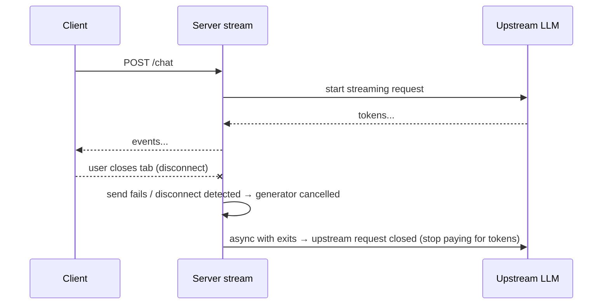

# FastAPI Streaming SSE and WebSockets

> [!abstract] What this is
> How FastAPI sends data incrementally: **streaming with `yield`** in path operations (JSON Lines and binary, 0.134), built-in **Server-Sent Events** (`EventSourceResponse` and `ServerSentEvent`, 0.135), lower-level `StreamingResponse`, and **WebSockets** for bidirectional traffic. Covers LLM token streaming, **client disconnects and cancellation**, keep-alives, proxy buffering and timeouts, resource lifetime during a stream, and scaling long-lived connections across workers and pods. The decision this helps with: picking SSE vs WebSockets vs JSON Lines for a feature, and keeping long-lived streams from leaking resources or blocking workers.

---

## Why It Matters

- LLM products stream tokens; dashboards push updates; uploads and exports stream bytes. A streaming endpoint holds a connection open for seconds to hours, so mistakes compound: blocked event loops, leaked DB sessions, upstream LLM calls that keep running (and billing) after the user closed the tab.

---

## Choosing a Mechanism

| | SSE (`text/event-stream`) | WebSockets | JSON Lines / chunked bytes |
|---|---|---|---|
| Direction | Server → client | **Both ways** | Server → client |
| Transport | Plain HTTP response (works over HTTP/1.1 and HTTP/2) | Upgrade to a WebSocket connection | Plain HTTP response |
| Browser API | `EventSource` (GET only, auto-reconnect, `Last-Event-ID`) or `fetch` streaming for POST | `WebSocket` | `fetch` + stream reader |
| Proxies / LBs | Usually fine (watch buffering and idle timeouts) | Need upgrade support and long idle timeouts | Usually fine |
| Pick when | **LLM token streams**, notifications, progress, logs; MCP over HTTP | Chat with typing indicators, collaborative editing, games, client → server streams | Bulk exports, machine-to-machine streaming, NDJSON APIs |

- Default to **SSE** for server push: simpler, HTTP-native, works with standard auth headers (via `fetch`), and FastAPI handles the protocol details.

---

## SSE in FastAPI (0.135+)

```python
from collections.abc import AsyncIterable
from fastapi.sse import EventSourceResponse, ServerSentEvent

class Token(BaseModel):
    text: str

@router.post("/chat", response_class=EventSourceResponse)
async def chat(req: ChatRequest, llm: Llm) -> AsyncIterable[ServerSentEvent]:
    async with llm.stream(req.messages) as stream:          # async LLM SDK: never a sync client here
        async for chunk in stream:
            yield ServerSentEvent(data=Token(text=chunk.text), event="token")
    yield ServerSentEvent(raw_data="[DONE]", event="done")
```

- `yield` in the path operation + `response_class=EventSourceResponse`: each yielded item becomes an SSE event, with `data` JSON-encoded (by Pydantic in Rust when the return type is declared, e.g. `AsyncIterable[Token]`).
- `ServerSentEvent` sets `event`, `id`, `retry`, comments; `raw_data` sends text without JSON encoding (`[DONE]` sentinels, log lines).
- Built in: a **keep-alive `ping` comment every 15 s** of silence, `Cache-Control: no-cache`, and **`X-Accel-Buffering: no`** so nginx doesn't buffer the stream.
- **Resuming**: browsers reconnect with the `Last-Event-ID` header; read it as a `Header()` parameter and continue from that id (requires events to be replayable, e.g. stored in Redis).
- SSE works with **POST** (FastAPI and MCP use it); browsers' `EventSource` only does GET, so clients use `fetch` streaming for POST.
- `def` generators also work (`Iterable[...]`); FastAPI iterates them in the thread pool so they don't block the loop.

### JSON Lines and binary

```python
@router.get("/export")                                         # 0.134: plain `yield` streams application/jsonl
async def export(svc: OrderSvc) -> AsyncIterable[OrderOut]:    # return type → validated + serialised in Rust
    async for order in svc.stream_all(batch=500):              # server-side cursor / keyset pagination
        yield order
```

- For files and media, `StreamingResponse(async_iterable, media_type=...)` or `FileResponse` (efficient file sending). `StreamingResponse` is the low-level option: no response-model validation, you produce bytes yourself.
- Streams start with a **200 and headers already sent**: an error halfway can't change the status. Send an error event (`event: error`) and close; clients must handle partial streams.

---

## Disconnects, Cancellation and Resource Lifetime



- When the client disconnects, the server's next send fails (or `request.is_disconnected()` turns true) and the generator is **cancelled** (`CancelledError` / `GeneratorExit` at its current `await`/`yield`).
- Put upstream calls inside **`async with`** / `try/finally` in the generator so cancellation **closes the upstream stream**; otherwise the LLM keeps generating (and billing) for nobody ([[01 - Async LLM Client Patterns]]).
- For generators that wait a long time between items, check `await request.is_disconnected()` periodically.
- Don't swallow `CancelledError` ([[05 - asyncio Internals]]).
- **Dependencies during streams**: yield dependencies with the default `scope="request"` stay open until the response finishes, so a DB session used by the generator remains valid; `scope="function"` would close it before streaming starts ([[03 - FastAPI Dependency Injection]]). Don't hold a DB connection for a minutes-long LLM stream: load data first, release the session, then stream.

---

## WebSockets

```python
from fastapi import WebSocket, WebSocketDisconnect

@app.websocket("/ws/rooms/{room_id}")
async def room(ws: WebSocket, room_id: str, user: Annotated[User, Depends(ws_user)]):
    await ws.accept()
    sub = await broker.subscribe(room_id)             # e.g. Redis pub/sub for cross-worker fan-out
    try:
        async with asyncio.TaskGroup() as tg:
            tg.create_task(pump_from_broker(sub, ws))     # server → client
            tg.create_task(pump_from_client(ws, room_id)) # client → server
    except* WebSocketDisconnect:
        pass
    finally:
        await sub.close()
```

- Dependencies work on WebSocket routes (path, query, headers, cookies); there's no request body, and **browsers can't set custom headers** on WebSocket handshakes: authenticate with a cookie, a short-lived token in the query/subprotocol, or a first message after `accept()`. Validate `Origin` against cross-site WebSocket hijacking.
- Exceptions: `WebSocketDisconnect` on client close; close with explicit codes (`await ws.close(code=1008)` for policy violations).
- Message validation: parse each message with a Pydantic model (`Model.model_validate_json(await ws.receive_text())`), and cap message sizes.

---

## Scaling Long-Lived Connections

- Each open stream or socket is a task on a worker's event loop: cheap in memory, but **state is per process**. A message published in worker 1 doesn't reach clients connected to worker 2 or another pod.
- Fan-out across workers and pods: **Redis pub/sub / Streams, NATS, Kafka**, or a managed service (Pusher, Ably, API Gateway WebSockets). Workers subscribe and forward to their local connections.
- Load balancers: raise **idle timeouts** (the 15 s SSE pings help), enable WebSocket upgrades, and expect reconnects on deploys. Sticky sessions aren't needed when state lives in the broker.
- Graceful shutdown: on SIGTERM, stop accepting, tell clients to reconnect (SSE `retry`, WebSocket close code 1001), and close within the grace period ([[09 - FastAPI Production Deployment]]).
- Capacity: track open connections per worker; bound with Uvicorn `--limit-concurrency`, per-user connection limits, and backpressure (don't buffer unbounded messages for slow clients).

---

## Failure Modes

| Failure | What happens | Mitigation |
|---|---|---|
| **Sync LLM/HTTP client inside an async generator** | Event loop blocked for the whole stream | Async SDKs; `def` generators only for sync code |
| **Upstream not closed on disconnect** | Tokens generated and billed for nobody | `async with` around upstream streams; let cancellation propagate |
| **Proxy buffering** | Client receives everything at the end | `X-Accel-Buffering: no` (SSE default), disable buffering at the LB |
| **Idle timeouts at LB** | Streams cut after 30–60 s | Keep-alive pings; longer idle timeouts |
| **Error after the stream started** | Client sees a 200 with a truncated stream | Error events; clients handle partial streams |
| **DB session held for a long stream** | Pool exhaustion | Load first, release, then stream |
| **In-process fan-out only** | Messages miss clients on other workers/pods | Redis/NATS/Kafka pub/sub |
| **WebSocket auth via custom headers** | Doesn't work from browsers | Cookies or short-lived tokens; check `Origin` |
| **Unbounded per-client buffers** | Memory growth from slow clients | Bounded queues; drop or disconnect slow consumers |

---

## Interview Lines

> [!tip] Say it like this
> - "For server push like LLM tokens I use SSE: since 0.135 FastAPI streams events from a `yield` path operation with `EventSourceResponse`, adds keep-alive pings and disables proxy buffering."
> - "WebSockets are for genuinely bidirectional traffic; they need upgrade-capable load balancers and auth via cookies or tokens because browsers can't set headers on the handshake."
> - "When the client disconnects the generator is cancelled, so upstream LLM calls sit in `async with` blocks and stop when the user leaves."
> - "Once streaming starts the status is already 200, so failures are sent as error events."
> - "Connections are per worker process, so cross-worker fan-out goes through Redis pub/sub or a broker."

## Related Notes

- [[02 - FastAPI Request Lifecycle and Sync vs Async]] · [[03 - FastAPI Dependency Injection]] · [[09 - FastAPI Production Deployment]]
- [[05 - asyncio Internals]] · [[08 - Decorators Generators and Context Managers]] · [[01 - Async LLM Client Patterns]] · [[05 - Spring WebFlux and Reactive]] · [[Languages/README]]
