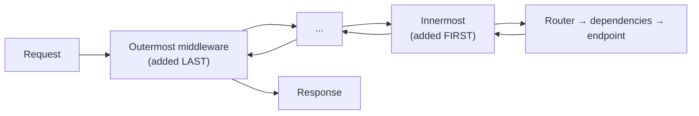

# FastAPI Security and Middleware

> [!abstract] What this is
> How to secure a FastAPI service and where cross-cutting code goes: FastAPI's **security utilities** (`OAuth2PasswordBearer`, `HTTPBearer`, `APIKeyHeader`, `Security` with scopes) as dependencies, **JWT validation** against an identity provider's JWKS, password hashing, **object-level authorisation**, **CORS**, rate limiting, security headers, request-size limits, and **middleware** (pure ASGI vs `BaseHTTPMiddleware`, ordering, what middleware can and can't see). Also centralised **exception handlers**. The decision this helps with: getting authentication, authorisation and middleware order right, and avoiding the common API vulnerabilities. The Spring equivalent is [[09 - Spring Security]].

---

## Why It Matters

- FastAPI gives building blocks, not a security framework: there's no default-deny. An endpoint without an auth dependency is **public**.
- Middleware order and type affect correctness (CORS preflights failing auth), performance (`BaseHTTPMiddleware` overhead) and streaming.

---

## Authentication as Dependencies

```python
from typing import Annotated
import jwt                                          # PyJWT
from fastapi import Depends, HTTPException, Security, status
from fastapi.security import HTTPAuthorizationCredentials, HTTPBearer, SecurityScopes

bearer = HTTPBearer(auto_error=False)                # documents the scheme in OpenAPI
jwks = jwt.PyJWKClient(settings.jwks_url, cache_keys=True)

async def current_user(
    scopes: SecurityScopes,
    creds: Annotated[HTTPAuthorizationCredentials | None, Depends(bearer)],
) -> User:
    if creds is None:
        raise HTTPException(status.HTTP_401_UNAUTHORIZED, headers={"WWW-Authenticate": "Bearer"})
    try:
        key = jwks.get_signing_key_from_jwt(creds.credentials).key   # cached; fetches on unknown kid
        claims = jwt.decode(creds.credentials, key,
                            algorithms=["RS256"],                    # pin algorithms: never accept "none"
                            audience=settings.audience,              # reject tokens issued for other APIs
                            issuer=settings.issuer)
    except jwt.PyJWTError:
        raise HTTPException(status.HTTP_401_UNAUTHORIZED, headers={"WWW-Authenticate": "Bearer"})
    granted = set(claims.get("scope", "").split())
    if not set(scopes.scopes) <= granted:
        raise HTTPException(status.HTTP_403_FORBIDDEN, "insufficient scope")
    return User(id=claims["sub"], scopes=granted)

CurrentUser = Annotated[User, Security(current_user)]
OrdersReader = Annotated[User, Security(current_user, scopes=["orders:read"])]

@router.get("/orders/{order_id}")
async def get_order(order_id: str, user: OrdersReader, svc: OrderSvc) -> OrderOut:
    return await svc.get_for_owner(order_id, owner_id=user.id)       # object-level check in the service
```

- Security classes (`OAuth2PasswordBearer`, `HTTPBearer`, `APIKeyHeader/Query/Cookie`) only **extract** credentials and declare the scheme in OpenAPI; validation is your dependency.
- `PyJWKClient` fetches and caches the provider's signing keys. Its fetch is **synchronous**; do it at startup or accept the occasional blocking refresh, or use an async JWKS fetch.
- Validate **signature, `exp`, `iss`, `aud`**, and pin algorithms (no `none`, no HS/RS confusion).
- **Default-deny**: attach the auth dependency at the router level (`APIRouter(dependencies=[Security(current_user)])`) and opt specific public routes out by putting them on a separate router.
- Issuing your own tokens (password flow): hash with **Argon2 or bcrypt** (`pwdlib`, `argon2-cffi`), compare with constant-time checks, short-lived access tokens + refresh tokens. Prefer an identity provider (Keycloak, Auth0, Cognito, Entra) over building login yourself.

### Authorisation

- Roles/scopes: `Security(..., scopes=[...])` or role-check dependency factories ([[03 - FastAPI Dependency Injection]]).
- **Object-level authorisation** (can this user see *this* order?) belongs in the service/query (`WHERE owner_id = :user`). It's the most common API vulnerability (BOLA); route-level checks can't catch it.
- Multi-tenant apps: resolve the tenant in a dependency and make it a required argument of repositories, so queries can't forget it.

---

## Middleware



- `app.add_middleware(X)` wraps the existing stack, so the **last added runs first** on the request. Starlette's `ServerErrorMiddleware` is always outermost and `ExceptionMiddleware` innermost.
- Typical order, outermost → innermost: **request ID / tracing → CORS → (trusted host, HTTPS redirect) → GZip → rate limiting → app**. CORS must be outside anything that could reject preflight `OPTIONS` requests.

| Type | How | Trade-offs |
|---|---|---|
| **Pure ASGI middleware** (class with `async __call__(scope, receive, send)`) | Wraps the raw ASGI app | Fastest; works with streaming and WebSockets; more code |
| **`@app.middleware("http")` / `BaseHTTPMiddleware`** | `async def mw(request, call_next)` | Convenient; extra overhead per request; reading the body consumes it; `contextvars` set inside may not propagate as expected |

```python
class RequestIdMiddleware:
    def __init__(self, app): self.app = app
    async def __call__(self, scope, receive, send):
        if scope["type"] != "http":
            return await self.app(scope, receive, send)
        request_id = dict(scope["headers"]).get(b"x-request-id", uuid.uuid4().hex.encode())
        token = request_id_var.set(request_id.decode())     # contextvar for logs
        async def send_with_id(message):
            if message["type"] == "http.response.start":
                message.setdefault("headers", []).append((b"x-request-id", request_id))
            await send(message)
        try:
            await self.app(scope, receive, send_with_id)
        finally:
            request_id_var.reset(token)
```

- Middleware sees raw requests: **no parsed body, no route params, no dependencies**. Per-route concerns (auth, tenant, permissions) are dependencies.
- Don't read the body in middleware unless you re-inject it; and don't buffer whole responses (breaks streaming) ([[06 - FastAPI Streaming SSE and WebSockets]]).

### Built-in and common middleware

| Middleware | Notes |
|---|---|
| `CORSMiddleware` | Explicit `allow_origins` list; `allow_credentials=True` can't be combined with `"*"`; CORS is a browser rule, not access control |
| `TrustedHostMiddleware` | Reject unexpected `Host` headers |
| `GZipMiddleware` | Compress large responses (`minimum_size`); skip for already-compressed or streaming content where it hurts |
| `HTTPSRedirectMiddleware` | Usually handled at the load balancer |
| `ProxyHeadersMiddleware` / Uvicorn `--proxy-headers` | Trust `X-Forwarded-*` only from known proxies ([[06 - WSGI vs ASGI and Python Servers]]) |
| OpenTelemetry | Built into FastAPI since 0.142 ([[09 - FastAPI Production Deployment]]) |

---

## Other Protections

| Concern | Approach |
|---|---|
| **Rate limiting** | At the gateway/LB first; in-app with `slowapi` or a Redis token bucket keyed by user/API key; return 429 + `Retry-After` |
| **Request size** | Limit at the proxy (nginx `client_max_body_size`); stream uploads (`UploadFile`) instead of reading into memory; cap list lengths in models |
| **Security headers** | HSTS, `X-Content-Type-Options`, CSP for HTML; often at the edge |
| **Content type** | Since 0.132 JSON bodies require a JSON `Content-Type` (mitigates some CSRF-by-form tricks) |
| **CSRF** | Only relevant for cookie-based auth: SameSite cookies + CSRF tokens; bearer-token APIs aren't vulnerable |
| **Docs exposure** | Disable or protect `/docs`, `/openapi.json` for private APIs |
| **Secrets** | `SecretStr` settings from env/secret mounts ([[04 - Pydantic v2 Deep Dive]]); never log tokens |
| **SSRF** | Allow-list outbound hosts for user-supplied URLs; block private ranges and metadata IPs |
| **Injection** | Bound parameters with SQLAlchemy; never format SQL strings ([[05 - FastAPI Data Access with SQLAlchemy]]) |

---

## Exception Handlers

```python
@app.exception_handler(DomainError)
async def domain_error(request: Request, exc: DomainError) -> JSONResponse:
    return JSONResponse(
        status_code=exc.status,
        content={"type": exc.type_uri, "title": exc.title, "detail": exc.detail,
                 "instance": str(request.url.path), "request_id": request_id_var.get()},
        media_type="application/problem+json",
    )

@app.exception_handler(Exception)
async def unhandled(request: Request, exc: Exception) -> JSONResponse:
    log.exception("unhandled error")                      # full traceback in logs only
    return JSONResponse(status_code=500, content={"title": "Internal Server Error"})
```

- Map domain exceptions to **Problem Details**-style JSON in one place ([[10 - Python Errors and Exception Groups]], [[10 - Spring Validation Errors and API Design]]). Override `RequestValidationError` to customise 422 bodies (and avoid echoing input back verbatim).
- `HTTPException` is for the HTTP layer (dependencies, endpoints); services raise domain exceptions.
- Errors raised **after a streaming response started** can't become a different status ([[06 - FastAPI Streaming SSE and WebSockets]]).

---

## Failure Modes

| Failure | What happens | Mitigation |
|---|---|---|
| **Endpoint without auth dependency** | Public by accident | Router-level auth; tests asserting 401 on every route |
| **JWT checked without `aud`/`iss` or with loose algorithms** | Tokens from other apps accepted; algorithm confusion | Pin algorithms; validate audience and issuer |
| **No object-level checks** | Users read others' data | Ownership in queries/services |
| **CORS inside auth / wrong order** | Preflights get 401 | CORS outermost (added last) |
| **`allow_origins=["*"]` with credentials** | Rejected or insecure | Explicit origins |
| **`BaseHTTPMiddleware` on hot paths/streams** | Overhead, broken streaming/contextvars | Pure ASGI middleware |
| **Body read in middleware** | Endpoint sees empty body | Don't, or re-wrap `receive` |
| **Stack traces in error responses** | Information leak | Generic 500 body; details in logs |
| **No size limits** | Memory exhaustion from large bodies | Proxy limits, streaming uploads, model caps |

---

## Interview Lines

> [!tip] Say it like this
> - "In FastAPI auth is a dependency: security classes extract the token and declare the scheme in OpenAPI, and my dependency validates the JWT's signature, expiry, issuer and audience against the provider's JWKS."
> - "There's no default-deny, so I put the auth dependency on the router and test that every route returns 401 without a token."
> - "Object-level authorisation lives in the service queries; route checks can't stop users reading each other's orders."
> - "The last middleware added runs first; CORS goes outermost so preflights aren't rejected, and I prefer pure ASGI middleware over `BaseHTTPMiddleware` for performance and streaming."
> - "Domain exceptions map to problem-details JSON in one exception handler; stack traces stay in the logs."

## Related Notes

- [[01 - FastAPI Architecture]] · [[03 - FastAPI Dependency Injection]] · [[09 - FastAPI Production Deployment]] · [[10 - FastAPI Testing]]
- [[09 - Spring Security]] · [[10 - AI Gateway Security and Guardrails]] · [[Languages/README]]
