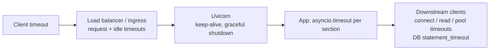

# FastAPI Production Deployment

> [!abstract] What this is
> Running FastAPI in production on the standard (GIL) build: the server setup (**`fastapi run` / Uvicorn**, workers per pod), **timeouts** at every layer (FastAPI has none by default), **graceful shutdown** in Kubernetes, **health checks** (liveness vs readiness), **observability** with FastAPI's **built-in OpenTelemetry** (0.142+, exporter auto-setup opt-in since 0.143), structured logging and metrics, configuration and secrets, and capacity planning. The decision this helps with: a deployment that uses its CPUs, survives slow dependencies and deploys, and can be debugged from telemetry.

---

## Why It Matters

- FastAPI apps that work in development fail in production for operational reasons: one worker per pod with blocking code, no timeouts, health checks that call the database, dropped requests on every deploy, no trace of why p99 doubled.

---

## Server Setup

```bash
# Simple: FastAPI CLI (runs Uvicorn)
fastapi run app/main.py --host 0.0.0.0 --port 8000 --workers 2 --proxy-headers

# Explicit Uvicorn
uvicorn app.main:app --host 0.0.0.0 --port 8000 --workers 2 \
  --proxy-headers --forwarded-allow-ips="10.0.0.0/8" \
  --timeout-keep-alive 75 --timeout-graceful-shutdown 25 --limit-concurrency 1000
```

| Decision | Guidance |
|---|---|
| Workers per pod | Under the GIL, parallelism = processes. Either **1 worker per pod** and scale pods (simplest resource accounting), or workers ≈ pod CPU limit ([[06 - WSGI vs ASGI and Python Servers]]) |
| uvloop / httptools | Installed with `fastapi[standard]` / `uvicorn[standard]`; faster event loop and HTTP parsing |
| Proxy headers | Trust `X-Forwarded-*` only from the load balancer's network |
| Concurrency cap | `--limit-concurrency` returns 503 beyond N in-flight requests instead of queueing forever |
| Keep-alive | Longer than the load balancer's idle timeout, or the LB reuses closed connections (502s) |
| Gunicorn + Uvicorn workers | Optional: for its process management (`max_requests` recycling, master restarts); Uvicorn's `--workers` supervisor covers the basics |

- Memory: each worker loads the app, its pools and any models; RSS × workers must fit the pod limit, with headroom ([[02 - Python Memory Management and GC]]).

---

## Timeouts at Every Layer



- **FastAPI and Uvicorn have no per-request timeout.** A request waits as long as its slowest downstream call.
- Set: client timeouts on every outbound call (`httpx.Timeout(connect=1, read=5, pool=1)`), DB `statement_timeout` and pool timeouts ([[05 - FastAPI Data Access with SQLAlchemy]]), `asyncio.timeout(...)` around multi-call sections, and an overall timeout at the ingress.
- Order them: **downstream < app section < ingress < client**, so the inner layer fails first with a meaningful error.
- LLM/streaming endpoints need longer ingress timeouts and keep-alive pings ([[06 - FastAPI Streaming SSE and WebSockets]]).

---

## Health Checks

```python
@app.get("/health/live", include_in_schema=False)
async def live() -> dict:
    return {"status": "ok"}                       # process is up and the loop responds

@app.get("/health/ready", include_in_schema=False)
async def ready(request: Request) -> dict:
    if request.app.state.shutting_down:
        raise HTTPException(503)
    async with asyncio.timeout(1):
        await request.app.state.db_ping()         # cached/cheap check of critical deps
    return {"status": "ready"}
```

| Probe | Checks | Never |
|---|---|---|
| **Liveness** | The event loop responds | Call the DB or downstreams (a DB blip would restart every pod) |
| **Readiness** | Critical dependencies reachable, not shutting down, warm-up done (models loaded) | Run heavy queries every second |
| **Startup** | Long initialisation (model loading) finished | Share the liveness timeout when startup is slow |

- A liveness probe timing out is often the first symptom of **a blocked event loop** ([[02 - FastAPI Request Lifecycle and Sync vs Async]]).
- Exclude health endpoints from telemetry (below) and access logs.

---

## Graceful Shutdown

1. Kubernetes removes the pod from endpoints and sends SIGTERM (roughly at the same time).
2. A **preStop** sleep (5–10 s) keeps serving while load balancers stop routing.
3. Uvicorn stops accepting, finishes in-flight requests up to `--timeout-graceful-shutdown`.
4. The **lifespan** exit runs: close pools and clients, stop background tasks ([[08 - FastAPI Background Work]]).
5. `terminationGracePeriodSeconds` must exceed preStop + graceful timeout, or the pod is SIGKILLed.

- The server must receive SIGTERM: exec-form `CMD ["fastapi", "run", ...]`, not a shell wrapper ([[11 - Python Packaging and Environments]]).
- Streams and WebSockets: send clients a reconnect hint and close within the window.

---

## Observability

### Built-in OpenTelemetry (0.142+)

```bash
export FASTAPI_OTEL_AUTO_CONFIGURE=true          # 0.143+: exporter setup from env is opt-in
export OTEL_SERVICE_NAME=orders-api
export OTEL_EXPORTER_OTLP_ENDPOINT=https://otel-collector.observability:4318
```

```python
app = FastAPI(
    lifespan=lifespan,
    telemetry={
        "exclude": lambda scope: scope["path"].startswith("/health"),
        "operation_spans": True,                  # spans for dependencies, endpoint, serialisation, background tasks
    },
)
```

- With `fastapi[standard]`, FastAPI records **HTTP request traces, metrics and logs** (unhandled exceptions as logs linked to traces; validation failures as warnings without the invalid input). WebSockets get traces and logs.
- **Since 0.143 exporters aren't added automatically**: enable with `FASTAPI_OTEL_AUTO_CONFIGURE=true` or `telemetry={"auto_configure": True}`, or configure OpenTelemetry providers yourself (FastAPI uses globally configured providers). Don't enable both auto-setup and another library exporting to the same destination (duplicate telemetry).
- Settings: `tracing`, `metrics`, `logs`, `operation_spans`, `exclude`, `auto_configure`, or pass providers explicitly.
- Exception logs may contain sensitive data: redact with log processors or disable `logs`.
- Outbound calls and DB queries still need instrumentation (OpenTelemetry instrumentations for httpx, SQLAlchemy/asyncpg, Redis) so traces show where time goes.
- **Sampling**: head-based probability sampling for volume; tail-based sampling in the collector keeps slow and error traces.

### Logs and metrics

- **Structured JSON logs** to stdout with trace and request IDs (contextvars, [[07 - FastAPI Security and Middleware]]); no request bodies or tokens.
- Golden signals per route (rate, errors, latency histograms), plus **event-loop lag**, thread-pool saturation, DB pool usage/wait, worker restarts, memory per worker. Prometheus via the OTel metrics pipeline or `prometheus-client` (multiprocess mode with several workers).
- Continuous profiling (py-spy / Pyroscope) to find hot or blocking code in production ([[13 - Python Performance and Profiling]]).

---

## Configuration and Secrets

- `pydantic-settings` loaded at startup, validated, from env vars and mounted secrets (`secrets_dir`), never committed `.env` files in images ([[04 - Pydantic v2 Deep Dive]]).
- Disable or protect `/docs` and `/openapi.json` for private APIs.
- Pin FastAPI, Starlette and Pydantic via the lockfile; upgrades are reviewed against release notes ([[00 - FastAPI Version History and Ecosystem]]).

---

## Capacity Planning

| Question | How to answer |
|---|---|
| Requests/sec per worker? | Load test (k6, locust) with production-like data; watch CPU per worker |
| CPU-bound or waiting? | High CPU per worker → more processes or less work; low CPU + high latency → downstream waits, loop blocking or pool limits |
| DB connections? | pods × workers × (pool_size + overflow) < `max_connections` with headroom |
| Memory? | RSS per worker × workers < limit; recycle if it grows |
| Autoscaling signal | CPU for CPU-bound services; in-flight requests or latency for I/O-bound ones (CPU stays low) |

---

## Failure Modes

| Failure | What happens | Mitigation |
|---|---|---|
| **No timeouts anywhere** | Requests hang; workers exhausted by one slow dependency | Layered timeouts |
| **Liveness probe calls the DB** | Restart storm on DB blips | Liveness local; dependencies in readiness |
| **Blocked event loop** | Liveness timeouts, mass restarts | Fix blocking calls; loop-lag metrics |
| **No preStop / short grace period** | 502s and dropped requests on deploy | preStop sleep + graceful shutdown within the grace period |
| **Expecting telemetry export by default on ≥ 0.143** | No data in the backend | `FASTAPI_OTEL_AUTO_CONFIGURE=true` or configure providers |
| **Auto-setup plus another exporter** | Duplicate traces/metrics | One export path |
| **Health checks traced and logged** | Noise and cost | `exclude` in telemetry; filter access logs |
| **Workers × pools > DB limit** | Connection errors on scale-out | Connection budget; PgBouncer |
| **Prometheus client with multiple workers, default mode** | Each scrape hits a random worker | Multiprocess mode or OTel push |

---

## Interview Lines

> [!tip] Say it like this
> - "Under the GIL I scale with processes: one or two Uvicorn workers per pod and more pods, sized from load tests."
> - "FastAPI has no request timeout, so I set timeouts on every client and the DB, `asyncio.timeout` around sections, and an ingress timeout, innermost shortest."
> - "Liveness only checks the process; readiness checks critical dependencies and flips to 503 during shutdown, with a preStop sleep so deploys don't drop requests."
> - "Since 0.142 FastAPI emits OpenTelemetry traces, metrics and logs itself; since 0.143 I opt into exporter setup with `FASTAPI_OTEL_AUTO_CONFIGURE` or configure providers myself."
> - "I watch event-loop lag, thread-pool and DB-pool saturation alongside latency, because those explain most FastAPI slowdowns."

## Related Notes

- [[02 - FastAPI Request Lifecycle and Sync vs Async]] · [[05 - FastAPI Data Access with SQLAlchemy]] · [[06 - FastAPI Streaming SSE and WebSockets]] · [[08 - FastAPI Background Work]]
- [[06 - WSGI vs ASGI and Python Servers]] · [[12 - Spring Observability]] · [[13 - Java in Containers and Production Tuning]] · [[Languages/README]]
