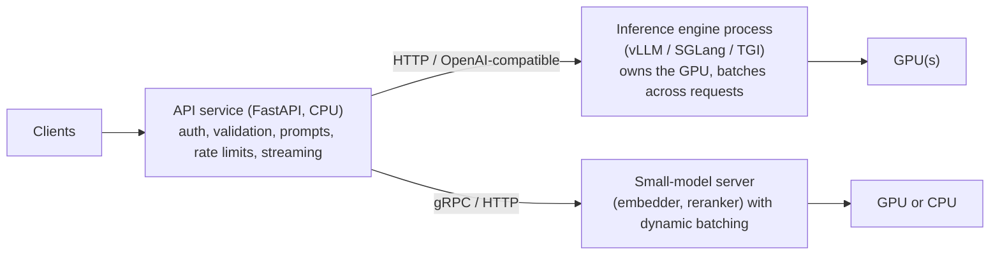

# Serving Models from Python

> [!abstract] What this is
> How to put models behind an API from Python: the **process architecture** (API processes vs **GPU worker processes**), why LLMs should be served by an engine (**vLLM**'s V1 engine, SGLang, TGI) via its **OpenAI-compatible server** or offline `LLM` API, what those engines do (continuous batching, paged KV cache, prefix caching, speculative decoding), serving smaller models (embedders, rerankers, classifiers) with dynamic batching (Triton, Ray Serve, TorchServe, a custom batcher), and the operational parts: model loading, health/readiness, autoscaling on GPU metrics, and cost. Architecture-level GPU serving is in [[13 - GPU Serving and Disaggregated KV Cache]] and [[07 - LLM Inference Platform]].

---

## Why It Matters

- The most common mistake is loading the model inside FastAPI web workers: N workers × weights per GPU → OOM, no batching, event loop blocked by forward passes.
- A naive `generate()` server gets maybe a few requests per second on a GPU that an engine with continuous batching would drive at an order of magnitude more throughput.

---

## Process Architecture



| Layer | Owns | Scales by |
|---|---|---|
| **API service** | Business logic, auth, tenancy, prompt assembly, tool calls, streaming to clients | CPU, replicas |
| **Inference engine** | Model weights, KV cache, batching, scheduling | GPUs (replicas, tensor/pipeline parallelism) |
| **Small-model server** | Encoders, classifiers | Batches per GPU/CPU |

- **One process owns each GPU** (or GPU group): one CUDA context, one copy of the weights, batching across all callers ([[04 - PyTorch for Inference Engineers]]).
- The API talks to the engine with the async OpenAI client pointed at the engine's `base_url` ([[01 - Async LLM Client Patterns]]); swapping between hosted APIs and self-hosted models becomes a config change.

---

## vLLM

```bash
vllm serve Qwen/Qwen3-8B --revision <sha> \
  --dtype bfloat16 --max-model-len 32768 \
  --gpu-memory-utilization 0.90 \
  --enable-prefix-caching \
  --api-key "$VLLM_API_KEY" --port 8000
```

```python
from openai import AsyncOpenAI
llm = AsyncOpenAI(base_url="http://vllm.inference.svc:8000/v1", api_key=settings.vllm_key)
resp = await llm.chat.completions.create(model="Qwen/Qwen3-8B", messages=msgs, stream=True,
                                         extra_body={"top_k": 20})        # engine-specific params
```

- **OpenAI-compatible server**: `/v1/chat/completions`, `/v1/completions`, `/v1/embeddings`, streaming, tool-call parsing, structured outputs (guided decoding with JSON schema), metrics at `/metrics`.
- **Offline API** for batch jobs: `LLM(model=...).generate(prompts, SamplingParams(...))` processes a whole dataset with maximum throughput, no HTTP.
- What the engine does for you:

| Feature | Effect |
|---|---|
| **Continuous batching** | New requests join the running batch every step; no waiting for the longest sequence |
| **PagedAttention** | KV cache in fixed blocks: little fragmentation, more concurrent sequences |
| **Prefix caching** | Shared prompt prefixes (system prompts, documents) reuse KV blocks: lower TTFT and cost |
| **Chunked prefill** | Long prompts split so they don't stall decoding for others |
| **Speculative decoding** | Draft model / MTP heads propose tokens, target verifies: lower latency |
| **Quantisation** | AWQ, GPTQ, FP8 checkpoints ([[05 - Hugging Face Stack]]) |
| **Parallelism** | `--tensor-parallel-size`, pipeline/data parallelism for big models |
| **Multi-LoRA** | Many adapters on one base model |

- `--gpu-memory-utilization` reserves most GPU memory up front for weights + KV cache; another process on the same GPU will OOM. `--max-model-len` trades context length for concurrency.
- **SGLang** (strong prefix-sharing/radix cache, structured generation) and **TGI** are alternatives; managed endpoints (cloud providers) run the same engines.

---

## Small Models: Embedders, Rerankers, Classifiers

- Throughput comes from **dynamic batching**: collect requests for a few ms (or until a max batch) and run one forward pass.

```python
class Batcher:
    def __init__(self, model, max_batch=64, max_wait_ms=5):
        self.q: asyncio.Queue[tuple[str, asyncio.Future]] = asyncio.Queue(maxsize=10_000)
        self.model, self.max_batch, self.max_wait = model, max_batch, max_wait_ms / 1000

    async def embed(self, text: str) -> np.ndarray:
        fut = asyncio.get_running_loop().create_future()
        await self.q.put((text, fut))
        return await fut

    async def run(self):                                   # one task, started in the lifespan
        while True:
            items = [await self.q.get()]
            deadline = asyncio.get_running_loop().time() + self.max_wait
            while len(items) < self.max_batch and (t := deadline - asyncio.get_running_loop().time()) > 0:
                try:
                    items.append(await asyncio.wait_for(self.q.get(), t))
                except TimeoutError:
                    break
            texts, futs = zip(*items)
            try:
                vecs = await asyncio.to_thread(self.model.encode, list(texts))   # GPU work off the loop
                for f, v in zip(futs, vecs):
                    f.set_result(v)
            except Exception as e:
                for f in futs:
                    f.set_exception(e)
```

- Off-the-shelf options: **vLLM** (embedding/pooling models), **Text Embeddings Inference (TEI)**, **NVIDIA Triton** (dynamic batching, multiple backends, ensembles), **Ray Serve** (Python-native, autoscaling, model composition), TorchServe.
- Keep the forward pass **off the event loop** (`to_thread` works because PyTorch releases the GIL during kernels; CPU-heavy pre/post-processing may still need processes) ([[08 - Python AI Performance Traps]]).

---

## Operations

| Concern | Practice |
|---|---|
| **Model loading** | Weights baked into images or on a fast volume; pinned revisions; load time measured (minutes for big models) |
| **Health** | Liveness = process alive; **readiness = model loaded and warmed** (first requests compile kernels / capture CUDA graphs); generous startup probes |
| **Autoscaling** | Scale on queue depth, KV-cache usage, in-flight requests or TTFT/latency, not CPU; GPU nodes take minutes to provision, so keep headroom |
| **Metrics** | Requests running/waiting, KV-cache utilisation, prefix-cache hit rate, TTFT, inter-token latency, tokens/s (vLLM exposes these) |
| **Limits** | Max context, max output tokens, per-tenant rate limits at the API layer; request timeouts |
| **Security** | Engines aren't hardened public APIs: keep them internal, require API keys/mTLS, put auth and guardrails in the API service ([[10 - AI Gateway Security and Guardrails]]) |
| **Cost** | GPU-hours per million tokens; batch offline work; right-size models; quantise ([[12 - LLM Cost and Latency Economics]]) |

---

## Failure Modes

| Failure | What happens | Mitigation |
|---|---|---|
| **Model loaded in every web worker** | N× VRAM, OOM, no batching | Dedicated inference process/service |
| **Forward pass on the event loop** | API stalls | Separate engine or `to_thread`/process |
| **`generate()` loop as LLM server** | Poor throughput, long queues | vLLM/SGLang/TGI |
| **Two processes sharing a GPU with vLLM's reservation** | OOM | One engine per GPU; tune `gpu-memory-utilization` |
| **Readiness before warm-up** | First requests very slow | Warm-up then readiness |
| **Autoscaling on CPU** | GPU service never scales | Queue depth / KV-cache / latency metrics |
| **Engine exposed publicly** | Abuse, cost, prompt attacks | Internal network; auth at the API layer |
| **No context/output caps** | One request hogs KV cache | `max-model-len`, `max_tokens` limits per tenant |
| **Downloading weights at startup** | Slow, failing scale-out | Pre-baked weights |

---

## Interview Lines

> [!tip] Say it like this
> - "I separate a CPU API service from GPU inference processes: one process owns each GPU, so there's one copy of the weights and batching across all callers."
> - "For LLMs I run vLLM's OpenAI-compatible server: continuous batching, PagedAttention and prefix caching give far more throughput than `generate()`, and the API calls it with the normal async OpenAI client."
> - "Embedders and rerankers get dynamic batching, a few milliseconds of queueing for a much bigger batch."
> - "Readiness waits for the model to load and warm up, and autoscaling uses queue depth, KV-cache usage or latency rather than CPU."
> - "The engine stays internal; auth, rate limits and guardrails live in the API layer."

## Related Notes

- [[01 - Async LLM Client Patterns]] · [[04 - PyTorch for Inference Engineers]] · [[05 - Hugging Face Stack]] · [[08 - Python AI Performance Traps]]
- [[13 - GPU Serving and Disaggregated KV Cache]] · [[07 - LLM Inference Platform]] · [[09 - FastAPI Production Deployment]] · [[Languages/README]]
