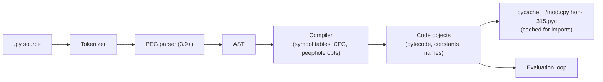
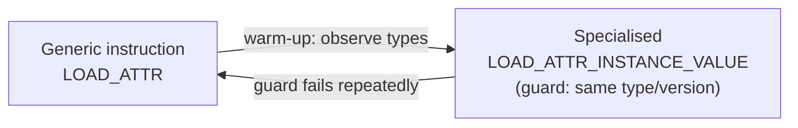
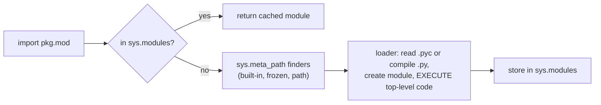

# CPython Execution Model

> [!abstract] What this is
> How CPython runs your code: **source → tokens → AST → bytecode** (cached in `.pyc`), the **evaluation loop** (a stack-based virtual machine running code objects in frames), the **specialising adaptive interpreter** (3.11) that makes hot bytecode faster by type-specialising it, the **experimental JIT** (3.13+), name and attribute lookup costs, and the **import system** (including 3.15 lazy imports). Everything here describes the standard GIL build; the eval loop is also where the GIL is held and released ([[03 - The GIL and Free-Threaded Python]]). The decision this helps with: explaining why pure-Python loops are slow, what actually got faster in 3.11+, and how to reason about startup and per-operation cost.

---

## Why It Matters

- "Why is Python slow?" has a precise answer: an interpreted, dynamically typed VM doing type checks, dictionary lookups and boxed-object operations for every bytecode. Knowing that tells you which code to vectorise, move to C, or leave alone.
- Startup cost (imports) dominates CLIs, serverless functions and worker restarts.

---

## From Source to Bytecode



- Each function, class body, module and comprehension compiles to a **code object**: bytecode, constants, variable names, line table, exception table.
- Imported modules are cached as **`.pyc`** in `__pycache__` (keyed by Python version, invalidated by source mtime/size or hash). The main script isn't cached.
- Compilation does only light optimisation (constant folding, dead-code removal); there's no type information at compile time.

```python
import dis

def total(prices, qty):
    return sum(p * qty for p in prices)

dis.dis(total)          # shows LOAD_FAST, CALL, RETURN_VALUE ... and specialised forms after warm-up
dis.dis(total, adaptive=True)
```

---

## The Evaluation Loop

- CPython's VM is **stack-based**: instructions push and pop **object references** on a per-frame value stack (`LOAD_FAST x`, `LOAD_FAST y`, `BINARY_OP +`, `STORE_FAST z`).
- Every value is a heap-allocated **`PyObject`** with a reference count and a type pointer ([[02 - Python Memory Management and GC]]). `a + b` means: look up the type's `__add__` slot, call it, allocate a result object, adjust reference counts.
- **Frames** hold locals, the value stack and the instruction pointer. Since **3.11** internal frames are lightweight structs allocated in a per-thread arena; full frame objects are created lazily only when needed (tracebacks, `sys._getframe`, debuggers).
- Function calls are comparatively expensive (argument parsing, frame setup); 3.11 inlined Python-to-Python calls in the eval loop so they no longer recurse in C.
- The loop periodically checks the **eval breaker** for signals, pending calls and GIL drop requests: that's how another thread gets the GIL every switch interval ([[03 - The GIL and Free-Threaded Python]]).

### Specialising adaptive interpreter (PEP 659, 3.11)



- After a few executions, instructions are **rewritten in place** into specialised forms using **inline caches**: `BINARY_OP` → `BINARY_OP_ADD_INT`, `LOAD_ATTR` → `LOAD_ATTR_INSTANCE_VALUE`, `LOAD_GLOBAL` → `LOAD_GLOBAL_MODULE`, `CALL` → `CALL_PY_EXACT_ARGS`.
- Each specialised instruction has a cheap **guard** (type or dict-version check); on failure it falls back and may re-specialise.
- Effect: code that is dynamically typed but **monomorphic in practice** (the same types at a site) runs much faster. Highly polymorphic sites stay generic.
- **Zero-cost exceptions** (3.11): `try` blocks cost nothing unless an exception is raised (exception tables replace setup instructions). Raising is still expensive.

### The JIT (experimental, 3.13+)

- A **copy-and-patch** JIT: hot "tier 2" traces of micro-operations are stitched from pre-compiled machine-code templates. Small and portable, modest speedups so far (single-digit percent in 3.15 on common platforms), larger expected over time.
- Off by default in source builds (`PYTHON_JIT=1` where built with JIT support); included in official Windows/macOS binaries since 3.14 as experimental.
- **3.14** also added a **tail-calling interpreter** variant (built with recent Clang) that speeds up the regular interpreter by a few percent.
- Not a PyPy-style JIT: objects are still boxed `PyObject`s with reference counting, so pure-Python numeric loops remain far slower than vectorised NumPy ([[13 - Python Performance and Profiling]]).

---

## Name and Attribute Lookup

| Lookup | Mechanism | Cost |
|---|---|---|
| **Local variable** | Array slot in the frame (`LOAD_FAST`) | Cheapest |
| **Closure variable** | Cell object (`LOAD_DEREF`) | Cheap |
| **Global / builtin** | Module dict, then builtins dict (`LOAD_GLOBAL`, specialised with dict version caching) | Cheap when specialised |
| **Instance attribute** | Instance `__dict__` (or inline values / `__slots__`), after checking the type for data descriptors | Moderate |
| **Method call** | Type MRO lookup + bound method (optimised to avoid creating the bound object) | Moderate |
| **`__getattr__` / properties / descriptors** | Python-level function calls | Expensive |

- Scope rule **LEGB**: Local → Enclosing → Global → Builtins, decided at **compile time** for locals (assigning anywhere in a function makes the name local: `UnboundLocalError` if read before assignment).
- Micro-optimisations like caching `append = out.append` matter much less since 3.11 specialisation; write clear code first, measure after.

---

## The Import System



- Importing a module **executes its top-level code** once per process; later imports return the cached object from **`sys.modules`**.
- Import cost = finding files on `sys.path` + unmarshalling `.pyc` + running top-level code (often importing heavy dependencies: pandas, torch, cloud SDKs). Measure with **`python -X importtime -c "import app"`**.
- **Circular imports**: module A imports B while A is half-initialised → `ImportError: cannot import name ... (most likely due to a circular import)`. Fix with restructuring, or importing modules (not names) and accessing attributes later.
- **Lazy imports (3.15, PEP 810)**: `lazy import pandas` / `lazy from x import y` binds a lazy object and imports on first use. Large startup and memory savings for CLIs and apps with many optional dependencies; side effects of module import happen later (and errors surface at first use).
- Fork-based servers import the app in the parent and fork workers, sharing imported code pages until they're touched ([[06 - WSGI vs ASGI and Python Servers]]).

---

## Other Implementations

| Implementation | Notes |
|---|---|
| **CPython** | Reference implementation; what "Python" means in production |
| **PyPy** | Tracing JIT; large speedups for pure-Python loops; C-extension compatibility and memory are the usual blockers |
| **GraalPy, MicroPython** | Niche: JVM embedding, microcontrollers |
| **Cython, mypyc, Nuitka** | Compile (typed) Python to C extensions or binaries; used for hot modules |

---

## Failure Modes

| Failure | What happens | Mitigation |
|---|---|---|
| **Hot pure-Python loops over large data** | Orders of magnitude slower than native | Vectorise (NumPy/Polars), move to C/Rust, batch ([[13 - Python Performance and Profiling]]) |
| **Heavy top-level imports** | Slow startup, slow worker restarts, memory per process | Lazy imports (3.15), import inside functions for rare paths, `-X importtime` |
| **Side effects at import time** | Network calls/DB connections during import; surprises in tests and forked workers | Create resources in explicit startup hooks |
| **Circular imports** | `ImportError` on partially initialised modules | Restructure; import modules not names |
| **Exceptions for control flow in hot paths** | Raising is expensive despite zero-cost `try` | Check conditions instead in tight loops |
| **Expecting the JIT to fix slow code** | Small gains | Algorithmic and vectorisation fixes first |

---

## Interview Lines

> [!tip] Say it like this
> - "CPython compiles source to bytecode cached in `.pyc` files and runs it on a stack-based VM where every value is a boxed, reference-counted object; that per-operation overhead is why pure-Python loops are slow."
> - "Since 3.11 the specialising adaptive interpreter rewrites hot instructions into type-specialised versions with guards, so code that's monomorphic in practice runs much faster; `try` blocks became zero-cost."
> - "There's an experimental copy-and-patch JIT since 3.13; it helps a bit, but vectorising or moving hot loops to native code still matters far more."
> - "Imports execute module code once and cache it in `sys.modules`; `-X importtime` finds slow imports, and 3.15's `lazy import` defers them."
> - "Locals are array slots, globals are specialised dict lookups, and attribute access goes through the type's descriptors, which is why properties and `__getattr__` cost more."

## Related Notes

- [[00 - Python Version History]] · [[02 - Python Memory Management and GC]] · [[03 - The GIL and Free-Threaded Python]] · [[07 - Python Data Model]] · [[13 - Python Performance and Profiling]]
- [[01 - JVM Architecture and Class Loading]] · [[05 - Compilation and Startup Compared]] · [[Languages/README]]
