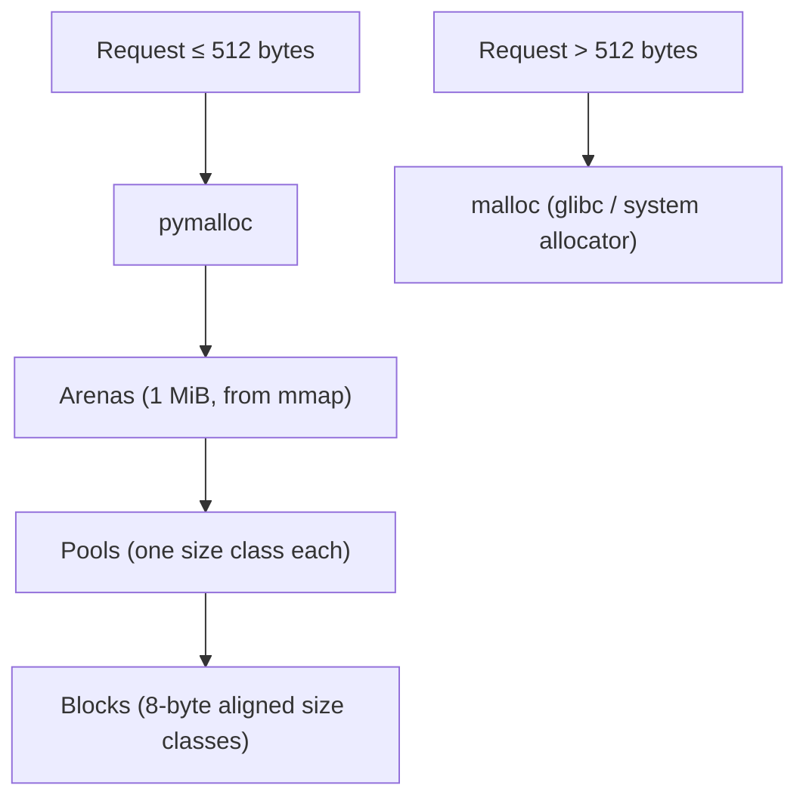

# Python Memory Management and GC

> [!abstract] What this is
> How CPython manages memory in the standard build: every value is a heap **`PyObject`** with a header, memory is freed primarily by **reference counting** (immediately, deterministically), a **cyclic garbage collector** handles reference cycles (generational; 3.14's incremental collector was reverted in 3.14.5 and 3.15), and the **pymalloc** allocator serves small objects from arenas, which is why process memory often doesn't shrink. Also: object sizes, immortal objects, copy-on-write after `fork`, and leak hunting. The decision this helps with: explaining a Python process's memory profile, sizing workers, and finding leaks.

---

## Why It Matters

- "Our Python worker grows to 2 GB and never shrinks" is a common production complaint; the answer is usually fragmentation, caches or a leak, and the tools to tell them apart are specific.
- Per-object overhead explains why a list of a million small objects costs hundreds of MB, and why NumPy arrays are so much smaller ([[02 - NumPy for Engineers]]).
- Pre-fork servers (Gunicorn, Celery) rely on copy-on-write sharing that reference counting quietly defeats.

---

## Everything Is an Object

```
PyObject (standard build, 64-bit)
+----------------+----------------+-------------------------+
| ob_refcnt (8)  | ob_type (8)    | type-specific fields... |
+----------------+----------------+-------------------------+
```

| Value | `sys.getsizeof` (approx., 64-bit) | Notes |
|---|---|---|
| `int` (small) | 28 bytes | Arbitrary precision; grows with magnitude |
| `float` | 24 bytes | A boxed C double |
| `str` | 49+ bytes (ASCII) | Compact representation: 1, 2 or 4 bytes per char depending on the widest character |
| `tuple` of n | 40 + 8n | References only, not the elements |
| `list` of n | 56 + 8·capacity | Over-allocates for amortised `append` |
| `dict` | ~180+ bytes for a few keys | Compact, insertion-ordered layout (3.6+) |
| Instance of a class | ~48–56 bytes + its attribute storage | `__slots__` removes the per-instance dict ([[07 - Python Data Model]]) |

- `sys.getsizeof` is **shallow**: a list's size excludes its elements. Use `tracemalloc`, `pympler.asizeof` or memray for real totals.
- A list of 1M floats ≈ 8 MB of pointers + 24 MB of float objects; a NumPy `float64` array of 1M is 8 MB.
- **Small int cache** (−5 to 256) and **string interning** (identifiers, some literals) share objects; that's why `is` sometimes "works" for small ints and short strings. Always compare values with `==`.

---

## Reference Counting

- Every reference (variable, container slot, argument) increments `ob_refcnt`; dropping it decrements. At **zero the object is freed immediately**, and its references are dropped recursively.
- Consequences:
    - **Deterministic cleanup**: files and sockets are closed as soon as the last reference goes (but still use `with`: other implementations and cycles don't guarantee it).
    - No stop-the-world pauses for most garbage.
    - Every reference change is a **memory write**, which is why the GIL exists (cheap, non-atomic refcount updates) ([[03 - The GIL and Free-Threaded Python]]) and why copy-on-write pages get dirtied after `fork`.
- **Immortal objects** (3.12, PEP 683): `None`, `True`, small ints and other core singletons have a fixed refcount that is never modified, avoiding cache-line contention and helping sharing across processes and interpreters.

## The Cyclic Garbage Collector

```python
class Node:
    def __init__(self): self.other = None

a, b = Node(), Node()
a.other, b.other = b, a     # cycle
del a, b                    # refcounts stay at 1: reference counting alone never frees them
```

- Only **container objects** (lists, dicts, class instances, ...) that can form cycles are tracked.
- The collector finds groups of objects reachable **only from each other** (subtracting internal references from refcounts) and frees them.
- **Generational**: new objects start in the youngest generation; survivors are promoted; older generations are scanned less often. Triggered by allocation counts (`gc.get_threshold()`), plus explicit `gc.collect()`.
- **3.14's incremental collector** (2 generations, old generation scanned in increments to cut pauses) shipped in 3.14.0–3.14.4 and was **reverted to the 3.13 generational collector in 3.14.5** (May 2026), and for 3.15, because cyclic garbage could pile up and cause significant memory growth in production. If you saw memory growth on early 3.14 patch releases, this is a likely cause.
- Objects with `__del__` in cycles are collectable since 3.4 (PEP 442), but finaliser order is undefined; prefer context managers and `weakref.finalize`.
- `gc.disable()` is occasionally used in latency-sensitive services that avoid cycles, with `gc.collect()` at safe points; `gc.freeze()` moves all current objects to a permanent generation (useful before forking, below).

---

## The Allocator: pymalloc and Arenas



- Small objects come from **pymalloc**: arenas split into pools, each pool serving one size class. Fast and low overhead.
- An **arena is returned to the OS only when every pool in it is empty**. A few long-lived objects scattered across arenas keep them all alive: **fragmentation**. RSS stays high after a spike even though Python has "freed" the objects and will reuse that memory.
- Large allocations go to the system allocator; glibc `malloc` has its own arena and trimming behaviour (`MALLOC_ARENA_MAX`, `malloc_trim`), and alternatives like jemalloc/mimalloc change the profile.
- The **free-threaded build uses mimalloc** for thread-safe allocation.

### Why memory doesn't go down

| Cause | Diagnosis |
|---|---|
| **Fragmented arenas** after a spike (big request, batch) | RSS high but `tracemalloc` current usage low; stable after the first spike |
| **Caches** (`lru_cache`, module dicts, ORM identity maps) | Growth tied to distinct keys; `tracemalloc` snapshots point to the cache |
| **Real leak** (references kept forever) | Steady growth under constant load |
| **C extension / native memory** | Not visible to `tracemalloc`; visible in memray native mode or RSS |

- Operational answer for workers: recycle them periodically (`max_requests` with jitter in Gunicorn, `max_tasks_per_child` in pools/Celery) and keep big one-off work in separate processes ([[06 - WSGI vs ASGI and Python Servers]]).

---

## Fork and Copy-on-Write

- Pre-fork servers load the app in the parent and fork workers; pages are shared until written.
- Reference counting and the GC **write to object headers** when objects are merely used or scanned, so shared pages get copied gradually: each worker's private memory grows towards a full copy.
- Mitigations: **`gc.freeze()`** in the parent right before forking (GC won't touch those objects), immortal objects for core singletons (3.12), loading large read-only data into **NumPy arrays or shared memory** (no per-element objects), or fewer workers with threads/async.
- Note 3.14's default start method change (Linux uses `forkserver`, not `fork`) ([[04 - Python Threads Processes and Executors]]); servers like Gunicorn still fork explicitly.

---

## Finding Leaks and Hogs

| Tool | Use |
|---|---|
| **`tracemalloc`** (stdlib) | Snapshots of Python allocations by line; compare two snapshots for growth |
| **memray** | Python **and native** allocations, flame graphs, live mode; best general tool |
| `gc.get_objects()`, `objgraph` | Count objects by type; find back-references keeping something alive |
| `sys.getrefcount`, `gc.get_referrers` | Spot-checks |
| Tachyon / py-spy | CPU profiling (not memory) ([[13 - Python Performance and Profiling]]) |

```python
import tracemalloc
tracemalloc.start(25)
before = tracemalloc.take_snapshot()
run_suspicious_workload()
after = tracemalloc.take_snapshot()
for stat in after.compare_to(before, "lineno")[:10]:
    print(stat)
```

### Common leak sources

- Module-level caches/dicts and registries that grow per request.
- **`functools.lru_cache` on methods**: caches `self`, keeping instances alive; unbounded `maxsize=None`.
- Closures and callbacks registered on long-lived objects (signals, event buses) and never removed.
- Storing exceptions (tracebacks hold frames, which hold locals).
- Accumulating `asyncio` tasks without awaiting or discarding them ([[05 - asyncio Internals]]).

---

## Failure Modes

| Failure | What happens | Mitigation |
|---|---|---|
| **Millions of small objects** | Huge memory per item | NumPy/Polars/arrays, `__slots__`, tuples, compact encodings |
| **Fragmentation after spikes** | RSS never shrinks | Recycle workers; isolate big jobs in subprocesses |
| **Unbounded caches** | Memory grows with key cardinality | `maxsize`, TTL caches, external caches |
| **CoW defeated in pre-fork servers** | Each worker grows to a full copy | `gc.freeze()` before fork, shared/NumPy data, fewer processes |
| **Relying on `__del__`** | Unpredictable cleanup, resurrection | Context managers, `weakref.finalize` |
| **Native leaks** | Invisible to `tracemalloc` | memray native mode; check extension versions |
| **Early 3.14 patch releases** | Cyclic garbage builds up (incremental GC) | Upgrade to 3.14.5+ |

---

## Interview Lines

> [!tip] Say it like this
> - "CPython frees most objects immediately through reference counting; a generational cyclic collector handles reference cycles among container objects."
> - "3.14 briefly shipped an incremental collector to cut pauses, but it was reverted in 3.14.5 and 3.15 because cyclic garbage could pile up and grow memory."
> - "Small objects come from pymalloc arenas, and an arena only goes back to the OS when it's completely empty, so RSS often stays high after a spike without being a leak."
> - "Every Python value is a boxed object with a header, so a million floats in a list cost about four times a NumPy array's memory."
> - "In pre-fork servers, refcount updates dirty shared pages, so I call `gc.freeze()` before forking and keep big read-only data in arrays."

## Related Notes

- [[01 - CPython Execution Model]] · [[03 - The GIL and Free-Threaded Python]] · [[04 - Python Threads Processes and Executors]] · [[06 - WSGI vs ASGI and Python Servers]] · [[13 - Python Performance and Profiling]]
- [[03 - JVM Memory Layout]] · [[02 - Memory and GC Compared]] · [[Languages/README]]
