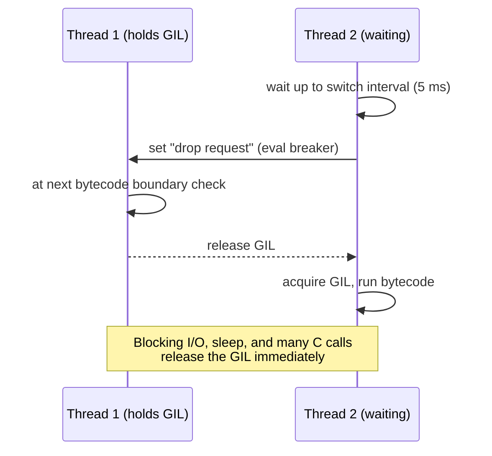

# The GIL and Free-Threaded Python

> [!abstract] What this is
> The **Global Interpreter Lock** in the standard CPython build (still the default in 3.14 and 3.15): what it protects, how threads take turns (the switch interval and eval breaker), why **I/O-bound threads scale and CPU-bound threads don't**, how C extensions release it, and why it **doesn't make your code thread-safe**. Then the options for CPU parallelism under the GIL (processes, native code, subinterpreters). The **free-threaded build** (experimental in 3.13, officially supported but opt-in in 3.14) is covered as an extra at the end. The decision this helps with: choosing threads, processes, async or native code for a workload on a normal Python deployment.

---

## Why It Matters

- "Explain the GIL" is the most common Python internals question, and the follow-ups test whether you know its practical consequences: thread pools for HTTP calls work fine, thread pools for JSON parsing or image resizing don't.
- Most production Python (official Docker images, distro packages, cloud runtimes) runs the **GIL build**. Free-threading is real but opt-in, with ecosystem caveats.

---

## What the GIL Is

- A single **mutex per interpreter** that a thread must hold to execute Python bytecode or touch Python objects through the C API.
- It exists because CPython's internals assume single-threaded access: **reference counts** are updated with plain (non-atomic) increments, and internal structures (dicts, lists, allocator state, the type cache) aren't individually locked ([[02 - Python Memory Management and GC]]). One big lock made the interpreter simple, fast for single-threaded code, and made C extensions easy to write.
- Result: **at most one thread runs Python bytecode at a time per interpreter**, regardless of core count.

### How threads take turns



- **Voluntary release**: blocking system calls (socket `recv`, file reads, `time.sleep`, `select`), lock waits, and C code that explicitly releases it (`Py_BEGIN_ALLOW_THREADS`).
- **Forced switching**: a waiting thread asks for the GIL after the **switch interval** (`sys.getswitchinterval()`, default **5 ms**); the running thread drops it at the next eval-breaker check.
- The OS decides which waiting thread gets it next; CPU-bound threads can starve I/O threads of responsiveness (the "convoy effect"), adding latency to I/O handling in mixed workloads.

---

## Consequences

| Workload | Threads under the GIL | Better option |
|---|---|---|
| **I/O-bound** (HTTP calls, DB queries, file I/O) | **Scale well**: GIL released while waiting | Threads or asyncio ([[05 - asyncio Internals]]) |
| **CPU-bound pure Python** (parsing, loops, business logic) | **No speedup**, often slower (contention, switching) | Processes ([[04 - Python Threads Processes and Executors]]), native code, vectorisation |
| **CPU-bound in C that releases the GIL** (NumPy ops, `hashlib` on large buffers, `zlib`, many ML kernels) | **Parallel** | Threads are fine |
| **Mixed** (CPU work in request handlers) | Request latency suffers for everyone | Offload CPU work to a process pool or native code |

```python
from concurrent.futures import ThreadPoolExecutor
import hashlib, httpx

# Scales: threads spend their time waiting on the network (GIL released)
with ThreadPoolExecutor(32) as pool:
    pages = list(pool.map(lambda u: httpx.get(u, timeout=5).text, urls))

# Also scales: hashlib releases the GIL for large inputs
with ThreadPoolExecutor(8) as pool:
    digests = list(pool.map(lambda b: hashlib.sha256(b).hexdigest(), big_blobs))

# Doesn't scale under the GIL: pure-Python CPU work
with ThreadPoolExecutor(8) as pool:
    results = list(pool.map(parse_and_score, records))   # ≈ single-core speed
```

### The GIL is not a thread-safety guarantee

- The GIL makes **individual bytecodes** atomic with respect to each other, not your operations. `counter += 1` is load, add, store: a switch between them loses updates.
- Some built-in operations happen to be atomic in CPython (`list.append`, `dict[key] = value`, `deque.append/popleft`) because they're a single C call, but that's an implementation detail, and **compound operations** (`if key not in d: d[key] = ...`) are races.
- Use `threading.Lock`, `queue.Queue`, or design for confinement. Code that is correct only "because of the GIL" breaks on the free-threaded build, and is often already wrong.

```python
import threading
lock = threading.Lock()
counter = 0

def work():
    global counter
    for _ in range(100_000):
        with lock:           # without the lock, updates are lost even with the GIL
            counter += 1
```

---

## Getting CPU Parallelism with the GIL Build

| Option | How | Trade-offs |
|---|---|---|
| **Processes** | `multiprocessing`, `ProcessPoolExecutor`, Gunicorn/Uvicorn workers | Separate memory per process; pickling cost for data; startup time ([[04 - Python Threads Processes and Executors]]) |
| **Native code that releases the GIL** | NumPy, Polars, PyTorch, Cython `nogil`, Rust (PyO3) | Fastest; requires vectorisable work or writing extensions |
| **Subinterpreters** (3.12 per-interpreter GIL; 3.14 `concurrent.interpreters`, `InterpreterPoolExecutor`) | Several interpreters in one process, **each with its own GIL** | Objects aren't shared (data passed by copying or via shareable types); extension modules must support multiple interpreters; young ecosystem |
| **Offload** | Task queues (Celery, arq), separate services | Operational complexity; latency |

- Web servers already parallelise across requests with **multiple worker processes**; the GIL limits parallelism **within** one process ([[06 - WSGI vs ASGI and Python Servers]]).

---

## Beyond the GIL: The Free-Threaded Build (extra)

> [!info] Not the default
> Free-threading is a **separate build** of CPython (`python3.13t`, `python3.14t`; installers offer it as an option, `uv python install 3.14t`). The normal `python3.14` and `python3.15` still have the GIL. Everything above applies to the normal build.

### Timeline

| Version | Status |
|---|---|
| **3.13** (2024) | Experimental (PEP 703), notable single-thread slowdown, specialising interpreter disabled in that build |
| **3.14** (2025) | **Officially supported** (PEP 779, "phase II"), still opt-in; specialisation enabled; single-thread overhead reduced to roughly 5–10% |
| **3.15** (2026) | Stable ABI for free-threaded extensions (`abi3t`, PEP 803), making wheels easier to ship |
| Later | Making it the default would be a future decision (a possible "phase III"), dependent on ecosystem readiness |

### How it works (in brief)

- **Biased reference counting**: the owning thread updates an object's refcount without atomics; other threads use atomic operations on a shared counter.
- **Deferred reference counting** and **immortalisation** for objects that are shared heavily (functions, code objects, types, interned strings), avoiding contention.
- **Per-object locks** ("critical sections") inside built-in containers so `list`/`dict` operations stay safe.
- **mimalloc** as a thread-safe allocator, and **QSBR** (quiescent-state-based reclamation) for safe memory reuse in lock-free reads.
- The GIL can be **re-enabled at runtime**: importing a C extension that doesn't declare free-threading support turns the GIL back on with a warning (unless forced off with `PYTHON_GIL=0` / `-X gil=0`). Check with `sys._is_gil_enabled()`.

### When to consider it

| Consider free-threading | Stay on the GIL build |
|---|---|
| CPU-bound work in pure Python that's hard to vectorise, where processes are too costly (shared large data, fine-grained tasks) | Typical web services (already multi-process) |
| All key dependencies publish free-threaded wheels | Dependencies without free-threaded support (GIL re-enabled anyway) |
| You can test thread-safety thoroughly | Code relying on GIL-implied atomicity |

- Code that was racy under the GIL becomes **more** visibly racy: audit shared mutable state, use locks and thread-safe queues.

---

## Failure Modes

| Failure | What happens | Mitigation |
|---|---|---|
| **Thread pool for CPU-bound Python** | No speedup; worse latency | Process pool, native code, vectorisation |
| **CPU work inside an I/O-heavy service** | All requests in the process slow down | Offload to processes/queues |
| **Relying on the GIL for correctness** | Lost updates; breaks on free-threaded builds | Locks, queues, immutable data |
| **Assuming free-threading is on** | No parallel speedup on normal builds | Check `sys._is_gil_enabled()`; use `python3.14t` deliberately |
| **Free-threaded build with unsupported extensions** | GIL silently re-enabled (with a warning) | Check wheels; watch for the warning in logs |
| **Many threads, long C calls holding the GIL** | Other threads stall | Prefer extensions that release the GIL; isolate in processes |

---

## Interview Lines

> [!tip] Say it like this
> - "The GIL is a per-interpreter mutex that lets only one thread run Python bytecode at a time; it exists mainly because reference counting and the interpreter's internals aren't thread-safe."
> - "Threads release it while blocked on I/O and in many C extensions, so thread pools work for HTTP calls or NumPy, but CPU-bound pure Python needs processes or native code."
> - "The GIL makes bytecodes atomic, not my operations; `counter += 1` still needs a lock."
> - "Default Python 3.14 and 3.15 still have the GIL. The free-threaded build is a separate, officially supported but opt-in interpreter since 3.14; it uses biased reference counting and per-object locks, and re-enables the GIL if an extension doesn't support it."
> - "Subinterpreters, each with its own GIL, are another option since 3.12, exposed in the stdlib as `concurrent.interpreters` in 3.14."

## Related Notes

- [[02 - Python Memory Management and GC]] · [[04 - Python Threads Processes and Executors]] · [[05 - asyncio Internals]] · [[06 - WSGI vs ASGI and Python Servers]]
- [[08 - Python AI Performance Traps]] · [[01 - Concurrency Models Compared]] · [[Languages/README]]
