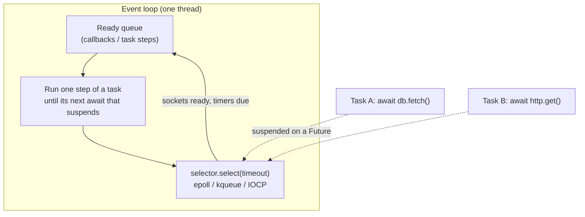

# asyncio Internals

> [!abstract] What this is
> How `asyncio` actually works: a single-threaded **event loop** multiplexing sockets with epoll/kqueue/IOCP, **coroutines** that suspend only at `await` points, **tasks** that schedule them, **futures** that connect callbacks to results, and structured concurrency with **`TaskGroup`** and **`asyncio.timeout`** (3.11). Covers **cancellation** rules, **blocking the loop** (the classic outage), bounded concurrency and back-pressure, `contextvars`, uvloop, and 3.14's task introspection. Written for the standard GIL build, where asyncio is the main way to handle many concurrent I/O operations in one process. The decision this helps with: writing async services that stay responsive and shut down cleanly.

---

## Why It Matters

- FastAPI, aiohttp, async SQLAlchemy, LLM SDK streaming and most modern Python network code run on asyncio ([[02 - FastAPI Request Lifecycle and Sync vs Async]]).
- One blocking call (`requests.get`, `time.sleep`, a CPU-heavy parse) freezes **every** request in the process. That single fact explains most async Python incidents.

---

## The Model



- The **event loop** repeatedly: runs every ready callback (each one a step of some task), then asks the OS which sockets are ready and which timers expired, then queues the corresponding callbacks.
- A **coroutine** (`async def`) is a resumable function. Calling it creates a coroutine object; **nothing runs** until it's awaited or wrapped in a task.
- `await x` runs `x` until it **suspends** on a **Future** (an I/O wait, a sleep, a lock); only then does control return to the loop. Code between awaits runs **without interruption**: no preemption, so no data races between tasks at that granularity, and no other task runs during a long CPU section.
- A **Task** wraps a coroutine and drives it step by step on the loop; `asyncio.create_task` schedules it to run concurrently.
- A **Future** is a placeholder for a result; low-level I/O resolves futures, and tasks waiting on them get rescheduled.

| | Coroutine | Task | Future |
|---|---|---|---|
| Created by | Calling `async def` | `create_task`, `TaskGroup.create_task` | Loop internals, `loop.create_future()`, `run_in_executor` |
| Runs | Only when awaited | Concurrently, scheduled by the loop | Not code: a result slot |
| Use | Sequential composition | Concurrency | Bridging callbacks/threads |

```python
async def main():
    a = fetch_user(1)                   # coroutine object, NOT running
    user = await a                      # runs now, sequentially

    t1 = asyncio.create_task(fetch_user(1))   # starts running concurrently
    t2 = asyncio.create_task(fetch_orders(1))
    user, orders = await t1, await t2         # total time ≈ max, not sum
```

---

## Structured Concurrency: TaskGroup and Timeouts (3.11)

```python
async def build_profile(user_id: int) -> Profile:
    async with asyncio.timeout(2):                       # deadline for the whole block
        async with asyncio.TaskGroup() as tg:
            user = tg.create_task(users.get(user_id))
            orders = tg.create_task(orders_api.recent(user_id))
            prefs = tg.create_task(prefs_api.get(user_id))
    return Profile(user.result(), orders.result(), prefs.result())
```

- **`TaskGroup`**: all tasks finish before the block exits; if one fails, the others are **cancelled** and the errors are raised together as an **`ExceptionGroup`** (handle with `except*`, [[10 - Python Errors and Exception Groups]]).
- **`asyncio.timeout(seconds)`** cancels the enclosed work at the deadline and raises `TimeoutError`; `asyncio.wait_for` does the same for one awaitable.

| | `asyncio.gather` | `TaskGroup` |
|---|---|---|
| On first failure | Raises it; **other tasks keep running** (unless you cancel them) | Cancels siblings, raises `ExceptionGroup` |
| `return_exceptions=True` | Collects exceptions as results | — |
| Lifetime | Tasks can outlive the call on error | Tasks never outlive the block |
| Pick when | Simple fan-out where partial results are fine | Default for related concurrent work |

---

## Cancellation

- `task.cancel()` throws **`CancelledError`** into the coroutine at its current `await`. Since 3.8 it's a **`BaseException`**, so `except Exception` doesn't swallow it.
- Rules:
    - Clean up in `finally` (or `async with`), then **let `CancelledError` propagate**. Swallowing it breaks `TaskGroup`, timeouts and shutdown.
    - Cancellation can arrive at **any** `await`: code between two awaits is atomic, but a multi-step operation spanning awaits can be interrupted halfway (design for it, or `asyncio.shield` the critical part).
    - `asyncio.shield(aw)` protects the inner awaitable from cancellation by the outer task (the outer await still raises).
- Timeouts are implemented as cancellation, so the same rules apply.
- Shutdown: `asyncio.run` cancels remaining tasks and waits for them; servers cancel request tasks after a grace period.

---

## Never Block the Loop

| Blocking call | Effect | Replacement |
|---|---|---|
| `requests.get`, sync DB drivers, sync SDKs | Loop frozen for the call's duration | `httpx.AsyncClient`, asyncpg / async SQLAlchemy, async SDKs; or `await asyncio.to_thread(fn)` |
| `time.sleep(1)` | Loop frozen 1 s | `await asyncio.sleep(1)` |
| CPU-heavy work (JSON of MBs, image processing, tokenisation) | Loop frozen; latency for all | `run_in_executor(process_pool, ...)` ([[04 - Python Threads Processes and Executors]]) |
| Synchronous file I/O on slow disks | Usually short but unbounded | `asyncio.to_thread`, `aiofiles`/anyio file APIs |
| Big synchronous logging handlers | Stalls | `QueueHandler` + listener thread |

- Detection: **debug mode** (`PYTHONASYNCIODEBUG=1` or `asyncio.run(main(), debug=True)`) logs callbacks slower than `loop.slow_callback_duration` (100 ms); loop-lag metrics (schedule a periodic callback and measure its delay); profilers (py-spy, Tachyon) showing time in non-async code.

---

## Bounded Concurrency and Back-Pressure

```python
sem = asyncio.Semaphore(20)                      # at most 20 calls in flight

async def fetch(client: httpx.AsyncClient, url: str) -> str:
    async with sem:
        r = await client.get(url, timeout=5)
        r.raise_for_status()
        return r.text

async def crawl(urls: list[str]) -> list[str]:
    async with httpx.AsyncClient() as client, asyncio.TaskGroup() as tg:
        tasks = [tg.create_task(fetch(client, u)) for u in urls]
    return [t.result() for t in tasks]
```

- Creating 100,000 tasks at once is cheap for asyncio but not for the downstream: bound with a **`Semaphore`**, a fixed number of worker tasks reading an **`asyncio.Queue(maxsize=...)`**, or the client's connection pool limits.
- Streams: `await writer.drain()` applies back-pressure when the peer reads slowly; unbounded buffering (queues without `maxsize`) turns slow consumers into memory growth.
- asyncio primitives (`Lock`, `Event`, `Semaphore`, `Queue`) are **not thread-safe**; from other threads use `loop.call_soon_threadsafe` or `asyncio.run_coroutine_threadsafe`.

---

## Tasks That Disappear

- The loop keeps only **weak references** to tasks. A task created with `create_task` and not stored anywhere can be **garbage-collected mid-flight**.
- "Fire and forget" needs a strong reference and error handling:

```python
background: set[asyncio.Task] = set()

def _on_done(task: asyncio.Task) -> None:
    background.discard(task)
    if not task.cancelled() and (exc := task.exception()) is not None:
        log.error("background task failed", exc_info=exc)

def spawn(coro) -> asyncio.Task:
    task = asyncio.create_task(coro)
    background.add(task)               # strong reference until done
    task.add_done_callback(_on_done)
    return task
```

- Better: a `TaskGroup` owned by the application lifespan, or a real task queue for work that must survive restarts ([[08 - FastAPI Background Work]]).
- "Task exception was never retrieved" in logs = a task failed and nobody awaited it.

---

## Context, Loops and Performance

- **`contextvars`**: each task gets a **copy** of the context at creation, so request-scoped values (trace id, user) flow into tasks it creates; changes inside a child don't leak back. This is the async-safe replacement for `threading.local`.
- **One loop per thread**; `asyncio.run()` creates and closes it. Don't call `asyncio.run` inside a running loop (e.g. from inside FastAPI handlers); await instead.
- **uvloop**: a drop-in loop on libuv, typically 2–4× faster loop overhead; Uvicorn uses it when installed ([[06 - WSGI vs ASGI and Python Servers]]).
- **Eager task factory** (3.12): tasks start running synchronously until their first suspension, avoiding a loop round-trip for coroutines that complete immediately (cache hits).
- **Introspection (3.14)**: `python -m asyncio ps <pid>` and `pstree <pid>` show running tasks and their await chains in a live process: the asyncio equivalent of a thread dump.
- **anyio / Trio**: structured-concurrency libraries; anyio runs on asyncio and is what Starlette/FastAPI use internally.

> [!info] Free-threaded build (extra)
> asyncio is still single-threaded per loop on `python3.14t`; free-threading lets you run several loops in threads in parallel, or offload CPU work to threads instead of processes. The loop rules above don't change.

---

## Failure Modes

| Failure | What happens | Mitigation |
|---|---|---|
| **Blocking call in a coroutine** | Every request in the process stalls | Async libraries; `to_thread`; process pools for CPU |
| **Forgotten `await`** | Coroutine never runs ("coroutine was never awaited" warning) | Type checkers flag unused coroutines; debug mode; tests |
| **Swallowed `CancelledError`** | Timeouts and shutdown hang | Re-raise after cleanup |
| **`gather` without cancellation on error** | Orphaned tasks keep running | `TaskGroup` |
| **Unreferenced background tasks** | Tasks vanish or fail silently | Keep references (ruff `RUF006` flags dangling `create_task`); done callbacks; lifespan task groups |
| **Unbounded fan-out** | Downstream overload, connection errors | Semaphores, worker pools, client limits |
| **No timeouts** | Requests wait forever on stuck peers | `asyncio.timeout` + client timeouts |
| **Using asyncio primitives across threads** | Races, "attached to a different loop" errors | `call_soon_threadsafe`, `run_coroutine_threadsafe` |
| **New client per request** | No connection reuse; slow; socket exhaustion | One `AsyncClient` per app lifespan |

---

## Interview Lines

> [!tip] Say it like this
> - "asyncio runs one event loop per thread; coroutines only give control back at an `await` that suspends, so code between awaits runs uninterrupted and a blocking call stalls everything."
> - "Calling an async function creates a coroutine that does nothing until awaited; `create_task` schedules it concurrently."
> - "I use `TaskGroup` and `asyncio.timeout` from 3.11: siblings are cancelled on failure and errors come back as an `ExceptionGroup`."
> - "`CancelledError` is a `BaseException`; I clean up in `finally` and re-raise, otherwise timeouts and shutdown break."
> - "I bound concurrency with a semaphore or a bounded queue, keep references to background tasks, and push blocking calls to `to_thread` and CPU work to a process pool."

## Related Notes

- [[04 - Python Threads Processes and Executors]] · [[06 - WSGI vs ASGI and Python Servers]] · [[10 - Python Errors and Exception Groups]] · [[03 - The GIL and Free-Threaded Python]]
- [[02 - FastAPI Request Lifecycle and Sync vs Async]] · [[01 - Async LLM Client Patterns]] · [[05 - Spring WebFlux and Reactive]] · [[01 - Concurrency Models Compared]] · [[Languages/README]]
