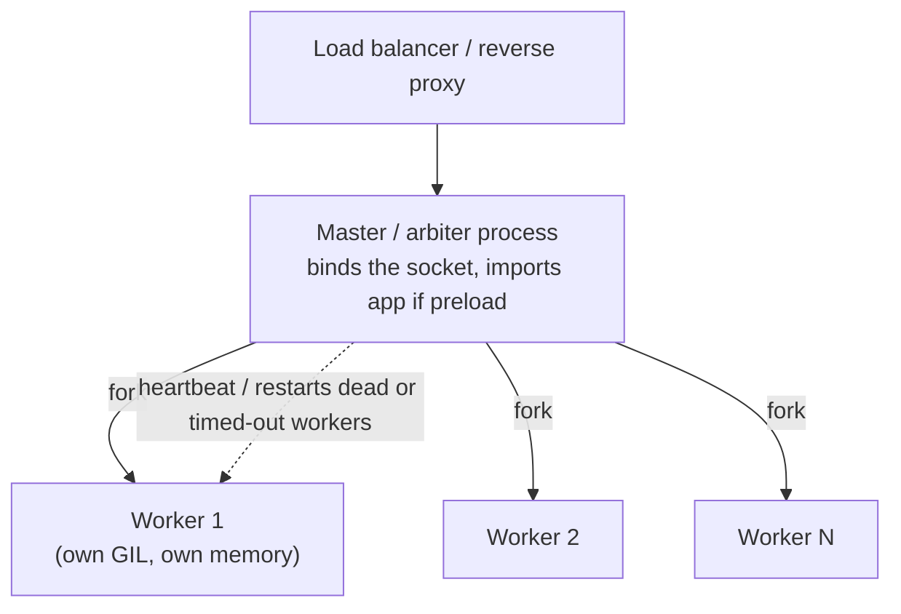

# WSGI vs ASGI and Python Servers

> [!abstract] What this is
> How Python web apps are served: the **WSGI** interface (synchronous, one request per worker thread) and the **ASGI** interface (asynchronous, lifespan + HTTP + WebSockets), the servers that implement them (**Gunicorn**, **Uvicorn**, Hypercorn, Granian), the **pre-fork worker model**, sizing workers and threads under the GIL, timeouts, worker recycling, and running behind a reverse proxy and in Kubernetes. The decision this helps with: configuring workers and timeouts for a Django/Flask or FastAPI service so it uses the CPUs it has and survives slow clients and deploys.

---

## Why It Matters

- Under the GIL, **parallelism across CPU cores comes from processes**: the worker model is how a Python service uses more than one core ([[03 - The GIL and Free-Threaded Python]]).
- Most Python web outages are configuration: too few workers, a sync worker blocked by a slow client, Gunicorn killing workers mid-request because of its timeout, or a deploy that drops in-flight requests.

---

## The Two Interfaces

| | WSGI (PEP 3333) | ASGI |
|---|---|---|
| Shape | `app(environ, start_response) -> iterable[bytes]` | `async app(scope, receive, send)` |
| Concurrency per worker | One request per thread (sync) | Many requests per event loop (async) |
| Protocols | HTTP request/response | HTTP, **WebSockets**, **lifespan** (startup/shutdown), streaming |
| Frameworks | Django (classic), Flask | FastAPI/Starlette, Django (ASGI mode), Quart, Litestar |
| Servers | Gunicorn, uWSGI, mod_wsgi, Waitress | Uvicorn, Hypercorn, Granian, Daphne |

```python
# WSGI: synchronous callable
def app(environ, start_response):
    start_response("200 OK", [("Content-Type", "text/plain")])
    return [b"hello"]

# ASGI: async callable, events in and out
async def app(scope, receive, send):
    if scope["type"] == "http":
        await send({"type": "http.response.start", "status": 200,
                    "headers": [(b"content-type", b"text/plain")]})
        await send({"type": "http.response.body", "body": b"hello"})
```

- ASGI's **lifespan** protocol lets the app open resources (DB pools, HTTP clients, models) at startup and close them at shutdown, per worker process ([[09 - FastAPI Production Deployment]]).

---

## The Pre-Fork Worker Model



- The master binds the listening socket and forks workers; the kernel distributes new connections among workers accepting on the shared socket.
- Each worker is an independent Python process: one GIL, its own memory, its own DB pool and clients. **Total DB connections = workers × pool size × pods** ([[05 - FastAPI Data Access with SQLAlchemy]]).
- **`preload_app`** imports the app in the master before forking: faster boot and shared memory pages (copy-on-write, partly defeated by refcounting; `gc.freeze()` helps) ([[02 - Python Memory Management and GC]]). Don't open sockets/connections at import time with preload: they'd be shared across forks.

### Gunicorn worker classes

| Worker class | Model | Pick when |
|---|---|---|
| `sync` (default) | One request at a time per process | CPU-light apps behind a buffering proxy; simplest |
| **`gthread`** | Thread pool per process (`--threads`) | **Typical Django/Flask** I/O-bound apps: threads overlap waits on DB/HTTP |
| `gevent` / `eventlet` | Green threads with monkeypatched stdlib | Many concurrent long-lived connections in sync code; monkeypatching surprises |
| **Uvicorn worker** (`uvicorn_worker.UvicornWorker`) | ASGI event loop per process | Running ASGI apps under Gunicorn's process management |

---

## ASGI Servers

| Server | Notes |
|---|---|
| **Uvicorn** | The standard for FastAPI; uvloop + httptools when installed (`uvicorn[standard]`); `--workers N` runs its own multi-process supervisor; `fastapi run` uses it |
| **Hypercorn** | HTTP/2 and HTTP/3, Trio support |
| **Granian** | Rust-based server (WSGI/ASGI/RSGI), high throughput, built-in process management |
| **Daphne** | Django Channels' original server |

- Uvicorn options that matter: `--workers`, `--limit-concurrency` (503 beyond N concurrent connections/tasks), `--backlog`, `--timeout-keep-alive`, `--timeout-graceful-shutdown`, `--proxy-headers` / `--forwarded-allow-ips` (trust `X-Forwarded-*` only from the proxy).

---

## Sizing Workers and Threads

| Setup | Starting point | Reasoning |
|---|---|---|
| Gunicorn `sync` | `2 × cores + 1` workers | Classic rule: some workers wait on I/O while others use CPU |
| Gunicorn `gthread` | `cores` to `2 × cores` workers × 4–16 threads | Threads cover I/O waits; processes cover CPUs |
| Uvicorn / ASGI | **1 worker per core** | One event loop already handles many concurrent I/O waits |
| Kubernetes | Often **1–2 workers per pod**, scale pods horizontally; or workers = pod CPU limit | Simpler resource accounting; let the orchestrator do process management |

- Base it on the **container's CPU limit**, not `os.cpu_count()` (which reports host CPUs) ([[04 - Python Threads Processes and Executors]]).
- Memory: each worker loads the app (and models, caches): RSS × workers must fit the limit. ML models per worker multiply memory ([[08 - Python AI Performance Traps]]).
- Measure under load: CPU per worker near 100% → more processes (or less CPU work per request); idle CPU with high latency → more concurrency (threads/async) or a downstream bottleneck.

---

## Timeouts, Recycling and Slow Clients

| Setting | What it does | Trap |
|---|---|---|
| Gunicorn `--timeout` (30 s) | Master kills a worker that hasn't **heartbeated** for N seconds | Long requests (reports, LLM streams) get killed mid-response with `WORKER TIMEOUT`; with async/thread workers it's about the worker being responsive, not the request |
| `--graceful-timeout` | Time for workers to finish on restart/shutdown | Shorter than Kubernetes `terminationGracePeriodSeconds` |
| `--keep-alive` | Idle keep-alive time | Must exceed the load balancer's idle timeout, or the LB reuses closed connections (502s) |
| `--max-requests` + `--max-requests-jitter` | Recycle workers after N requests | Contains leaks/fragmentation; jitter avoids all workers restarting together |
| Request timeouts | Not enforced by WSGI servers | Enforce at the proxy and in the app (DB/HTTP client timeouts) |

- **Slow clients**: a `sync` worker reading a slow upload or writing to a slow client is blocked the whole time. Put **nginx or a cloud LB that buffers** requests/responses in front, or use async/threaded workers.
- **Graceful shutdown**: on SIGTERM, Gunicorn/Uvicorn stop accepting and finish in-flight requests; add a short preStop delay so the load balancer stops sending traffic first. The server must be PID 1 or receive signals (exec-form entrypoint) ([[13 - Java in Containers and Production Tuning]] covers the same Kubernetes mechanics).

```bash
# Django/Flask
gunicorn app.wsgi:application --workers 4 --worker-class gthread --threads 8 \
  --timeout 30 --graceful-timeout 25 --keep-alive 75 --max-requests 2000 --max-requests-jitter 200

# FastAPI
uvicorn app.main:app --host 0.0.0.0 --port 8000 --workers 2 \
  --proxy-headers --forwarded-allow-ips="10.0.0.0/8" --timeout-graceful-shutdown 25
```

---

> [!info] Free-threaded build (extra)
> On `python3.14t`, a single process with many threads can use multiple cores, so `gthread`-style servers could need fewer processes and less memory. Server and framework support for free-threaded builds is still maturing; the default deployment remains multiple processes on the GIL build.

---

## Failure Modes

| Failure | What happens | Mitigation |
|---|---|---|
| **Too few workers for CPU work** | High latency, one core busy, others idle | Workers ≈ CPU limit (ASGI) or more with sync |
| **Sync workers + slow clients** | All workers stuck on uploads/downloads | Buffering proxy; threaded/async workers |
| **Gunicorn timeout on long requests** | `WORKER TIMEOUT`, killed responses | Async/thread workers; raise timeout deliberately; move long work to background jobs |
| **Keep-alive shorter than LB idle timeout** | Sporadic 502s | Server keep-alive > LB idle timeout |
| **Resources opened at import with preload** | Sockets shared across workers; corrupted connections | Open in post-fork hooks / ASGI lifespan |
| **Workers × pool size × pods > DB limit** | Connection errors on scale-out | Budget connections; poolers |
| **Memory grows per worker** | OOM kills | `max-requests` with jitter; fix leaks |
| **Trusting `X-Forwarded-For` from anyone** | IP spoofing in logs and rate limits | Allow proxy headers only from known proxies |

---

## Interview Lines

> [!tip] Say it like this
> - "WSGI is a synchronous callable, one request per worker thread; ASGI is async with lifespan and WebSockets, many requests per event loop."
> - "Under the GIL, servers get multi-core parallelism from pre-forked worker processes; each worker has its own GIL, memory and connection pools."
> - "For FastAPI I run about one Uvicorn worker per core, or one or two per pod and scale pods; for Django I'd use Gunicorn with `gthread` workers."
> - "Gunicorn's timeout kills workers that stop heartbeating, which bites long requests; I keep server keep-alive above the load balancer's idle timeout and recycle workers with jittered max-requests."
> - "Resources like DB pools are created per worker after fork, in the ASGI lifespan, never at import time with preload."

## Related Notes

- [[03 - The GIL and Free-Threaded Python]] · [[04 - Python Threads Processes and Executors]] · [[05 - asyncio Internals]] · [[02 - Python Memory Management and GC]]
- [[02 - FastAPI Request Lifecycle and Sync vs Async]] · [[09 - FastAPI Production Deployment]] · [[03 - Web Server Models Compared]] · [[Languages/README]]
