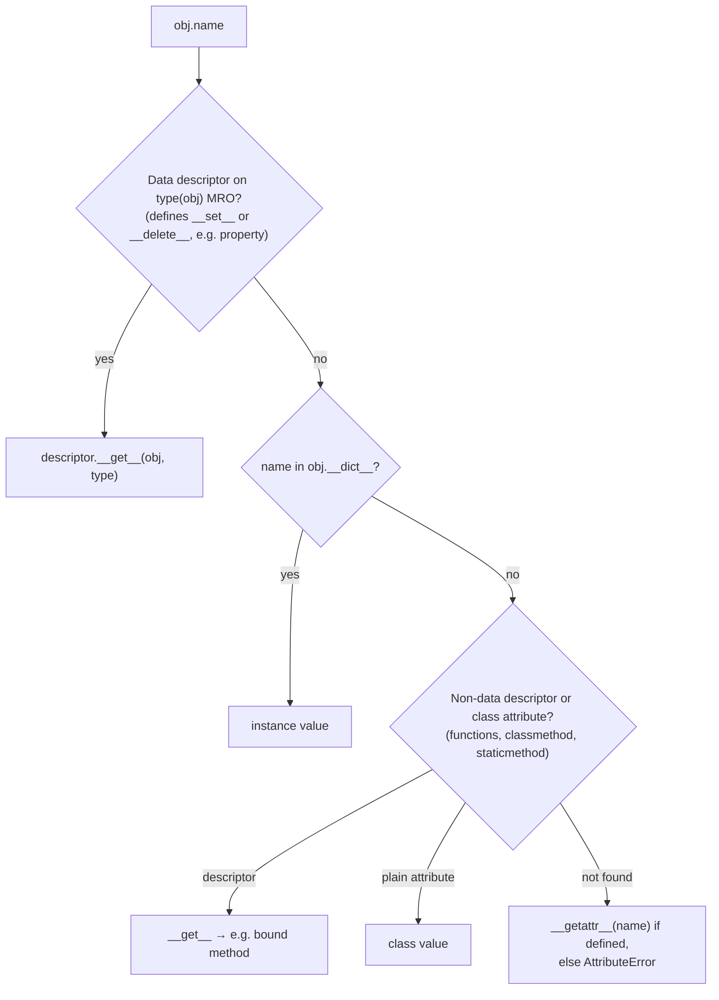

# Python Data Model

> [!abstract] What this is
> The protocols that make Python objects behave like built-ins: **dunder methods** (`__repr__`, `__eq__`/`__hash__`, ordering, container and numeric protocols, `__call__`, `__bool__`), the **attribute lookup order** and **descriptors** (the mechanism behind methods, `property`, `classmethod`, `__slots__`), **`__slots__`** for memory, the **MRO** and cooperative `super()`, and metaclasses vs `__init_subclass__` and class decorators. Also identity vs equality, mutability, and copying. The decision this helps with: writing classes that behave correctly in sets, dicts, sorting and frameworks, and reading framework code (ORMs, Pydantic, dataclasses) that relies on these hooks.

---

## Why It Matters

- Bugs from the data model are subtle: objects that vanish from sets after mutation, `__eq__` without `__hash__` making instances unhashable, properties hiding expensive work, mutable default arguments shared across calls.
- Django models, SQLAlchemy columns, Pydantic fields and dataclasses are all built on descriptors, `__set_name__`, `__init_subclass__` and metaclasses; knowing the hooks makes the "magic" readable.

---

## Identity, Equality, Mutability

- **Identity**: `a is b` (same object; `id()`); **equality**: `a == b` (`__eq__`). Use `is` only for singletons (`None`, sentinels, enums).
- **Mutable** built-ins: `list`, `dict`, `set`, `bytearray`, most class instances. **Immutable**: `int`, `float`, `str`, `bytes`, `tuple`, `frozenset`, `frozendict` (3.15).
- Variables are **names bound to objects**; assignment never copies. `b = a` with a list means both names see mutations.
- `copy.copy` (shallow: new container, same elements) vs `copy.deepcopy` (recursive; customise with `__copy__`/`__deepcopy__`).

```python
def add_item(item, items=[]):        # BUG: the default list is created ONCE, at def time
    items.append(item)
    return items

def add_item(item, items=None):      # correct
    items = [] if items is None else items
    items.append(item)
    return items
```

---

## The Core Dunder Methods

| Protocol | Methods | Used by |
|---|---|---|
| Representation | `__repr__` (unambiguous, for devs), `__str__` (for users), `__format__` | Logs, debuggers, f-strings |
| Equality and hashing | `__eq__`, `__hash__` | `==`, `dict` keys, `set` members |
| Ordering | `__lt__`, `__le__`, ... (`functools.total_ordering`) | `sorted`, `min`, `heapq` |
| Truthiness | `__bool__`, else `__len__` | `if obj:` |
| Containers | `__len__`, `__getitem__`, `__setitem__`, `__contains__`, `__iter__` | `len`, indexing, `in`, `for` |
| Callables | `__call__` | Function-like objects |
| Context managers | `__enter__`/`__exit__`, `__aenter__`/`__aexit__` | `with` ([[08 - Decorators Generators and Context Managers]]) |
| Numeric | `__add__`, `__radd__`, `__iadd__`, ... | Operators |
| Attribute access | `__getattr__`, `__getattribute__`, `__setattr__`, `__delattr__` | Proxies, lazy objects |

### `__eq__` and `__hash__`

- Defining `__eq__` without `__hash__` sets **`__hash__ = None`**: instances become **unhashable**.
- Contract: `a == b` ⇒ `hash(a) == hash(b)`. Hash only **immutable** fields; an object whose hash changes while inside a set/dict becomes unreachable (same rule as Java, [[07 - Java Collections Internals]]).
- Return **`NotImplemented`** (not `False`) from `__eq__`/operators for unsupported types, so Python tries the reflected operation.

```python
from dataclasses import dataclass

@dataclass(frozen=True, slots=True)          # generates __init__, __repr__, __eq__, __hash__; immutable; no __dict__
class Money:
    amount_cents: int
    currency: str

    def __add__(self, other: "Money") -> "Money":
        if not isinstance(other, Money):
            return NotImplemented
        if other.currency != self.currency:
            raise ValueError("currency mismatch")
        return Money(self.amount_cents + other.amount_cents, self.currency)
```

---

## Attribute Lookup and Descriptors



- A **descriptor** is any object on a **class** with `__get__` (and optionally `__set__`/`__delete__`). It intercepts attribute access on instances.
- **Functions are non-data descriptors**: `obj.method` calls `function.__get__(obj, type)`, which returns a **bound method**. That's how `self` gets passed.
- **`property`** is a data descriptor: it wins over the instance `__dict__`.
- **`__set_name__`** (3.6) tells a descriptor its attribute name at class creation: how ORMs and validation libraries know `email = Column(...)` is called `email`.
- `__getattr__` runs only when normal lookup **fails**; `__getattribute__` runs on **every** access (easy to make slow or recursive).

```python
class Positive:
    def __set_name__(self, owner, name):
        self.private = f"_{name}"
    def __get__(self, obj, objtype=None):
        return self if obj is None else getattr(obj, self.private)
    def __set__(self, obj, value):
        if value <= 0:
            raise ValueError(f"{self.private[1:]} must be positive")
        setattr(obj, self.private, value)

class OrderLine:
    quantity = Positive()                     # reusable validation for any attribute
    def __init__(self, quantity: int): self.quantity = quantity
```

- `functools.cached_property` is a non-data descriptor that stores the computed value in the instance `__dict__`; since 3.12 it no longer takes a lock, so concurrent first access may compute twice.

---

## `__slots__`

```python
class Point:
    __slots__ = ("x", "y")        # fixed attributes stored in slots, no per-instance __dict__
    def __init__(self, x, y): self.x, self.y = x, y
```

- Saves memory (no `__dict__`, often 40–60% per instance for small objects) and speeds attribute access slightly; prevents adding arbitrary attributes (typos fail loudly).
- Costs: no dynamic attributes, `__weakref__` must be listed for weak references, and inheritance needs care (every class in the chain must declare slots to get the benefit).
- Use for classes with **millions of instances**; `@dataclass(slots=True)` (3.10) generates them ([[02 - Python Memory Management and GC]]).

---

## Inheritance, MRO and super()

```python
class Base:            def save(self): print("Base")
class Audited(Base):   def save(self): print("Audited"); super().save()
class Cached(Base):    def save(self): print("Cached");  super().save()
class Order(Audited, Cached): pass

Order.__mro__   # Order → Audited → Cached → Base → object
Order().save()  # Audited, Cached, Base: each super() calls the NEXT class in the MRO, not the parent
```

- **C3 linearisation** gives a consistent **method resolution order**; `super()` follows the MRO of the **instance's class**, which makes **cooperative multiple inheritance** (mixins) work, provided every method calls `super()` and accepts `**kwargs` where signatures differ.
- Prefer composition and small mixins; deep hierarchies with diamond inheritance are hard to reason about ([[LLD/Foundations/03 - Object Modelling]]).
- **ABCs** (`abc.ABC`, `@abstractmethod`) give nominal interfaces with instantiation checks; **`Protocol`** gives structural typing for type checkers ([[09 - Python Typing]]).

---

## Class Creation: Metaclasses and Lighter Hooks

| Hook | Runs | Use |
|---|---|---|
| **Class decorator** | After the class is created | Add methods, register classes (`@dataclass`) |
| **`__init_subclass__`** (3.6) | When a subclass is defined | Plugin registries, validating subclasses |
| **`__set_name__`** | For each descriptor at class creation | Descriptors learning their names |
| **Metaclass** (`class Meta(type)`) | Controls class creation itself | ORMs (Django models), enums, ABCs; rarely needed in app code |

```python
class Handler:
    registry: dict[str, type["Handler"]] = {}
    def __init_subclass__(cls, *, event: str, **kwargs):
        super().__init_subclass__(**kwargs)
        Handler.registry[event] = cls

class OrderPlaced(Handler, event="order.placed"): ...
```

- Two metaclasses in one hierarchy must be compatible ("metaclass conflict"), one reason libraries moved to `__init_subclass__` and decorators.

---

## Failure Modes

| Failure | What happens | Mitigation |
|---|---|---|
| **Mutable default argument** | State shared across calls | `None` default + create inside |
| **`__eq__` without `__hash__`** | `TypeError: unhashable type` | Define both, or `@dataclass(frozen=True)` |
| **Hash over mutable fields** | Objects lost in sets/dicts after mutation | Hash immutable fields only |
| **`is` for value comparison** | Works for small ints/interned strings, fails otherwise | `==` for values, `is` for singletons |
| **Returning `False` instead of `NotImplemented`** | Reflected operations never tried | Return `NotImplemented` |
| **Expensive or I/O properties** | Hidden latency in attribute access | Explicit methods for expensive work |
| **Recursive `__getattribute__` / `__setattr__`** | `RecursionError` | Use `object.__getattribute__` / `super().__setattr__` |
| **`super()` chain broken in mixins** | Some mixins' methods skipped | Every class calls `super()`; pass `**kwargs` |
| **Shallow copy of nested data** | Mutations leak between "copies" | `deepcopy` or immutable structures |

---

## Interview Lines

> [!tip] Say it like this
> - "Python's operators and built-ins dispatch to dunder methods, so a class can behave like a container, a number or a context manager."
> - "Defining `__eq__` makes a class unhashable unless I also define `__hash__`, and the hash must only use immutable fields."
> - "Attribute lookup checks data descriptors on the type first, then the instance dict, then non-data descriptors and class attributes, then `__getattr__`; functions are descriptors, which is how bound methods get `self`."
> - "`super()` follows the instance's MRO, not the parent class, which is what makes cooperative mixins work."
> - "I use `__slots__` or `@dataclass(slots=True)` when there are millions of instances, and `__init_subclass__` instead of metaclasses for registries."

## Related Notes

- [[08 - Decorators Generators and Context Managers]] · [[09 - Python Typing]] · [[02 - Python Memory Management and GC]] · [[01 - CPython Execution Model]]
- [[04 - Pydantic v2 Deep Dive]] · [[LLD/Foundations/03 - Object Modelling]] · [[LLD/Foundations/02 - Immutability and Value Objects]] · [[Languages/README]]
